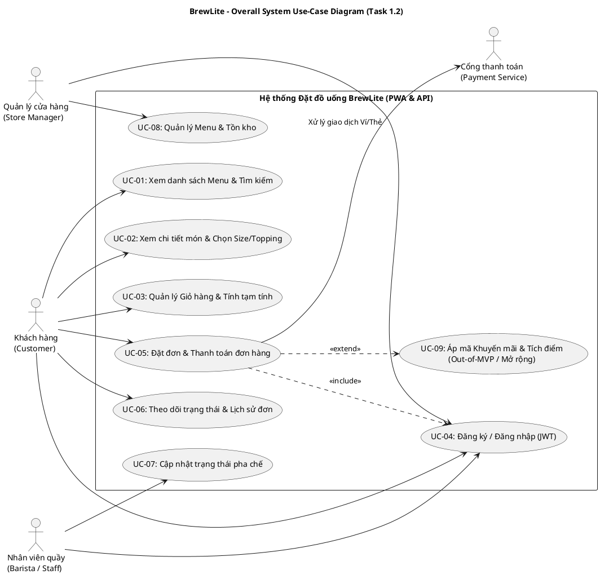
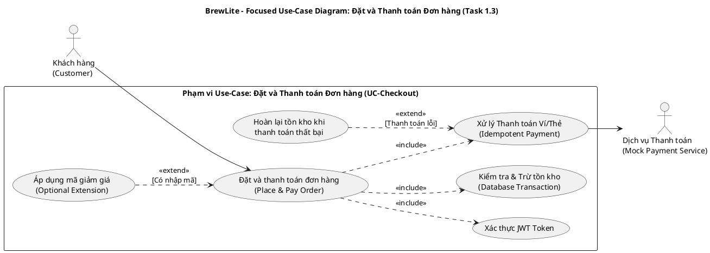
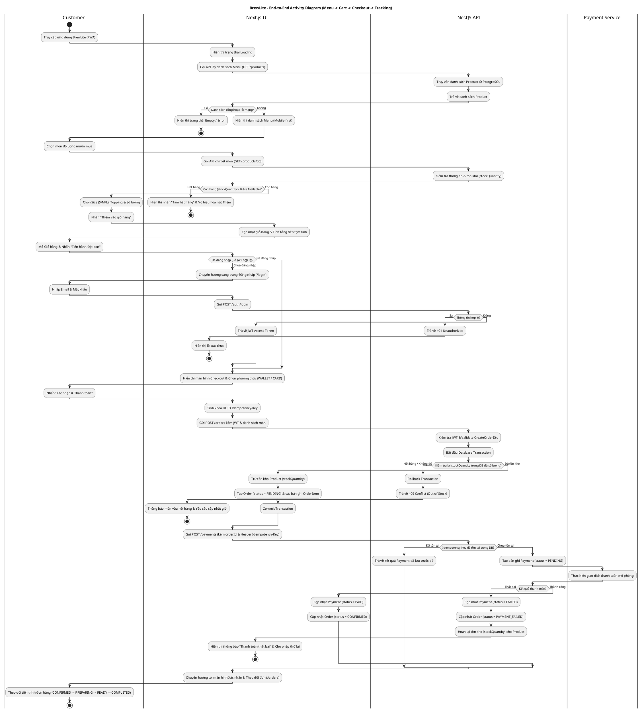
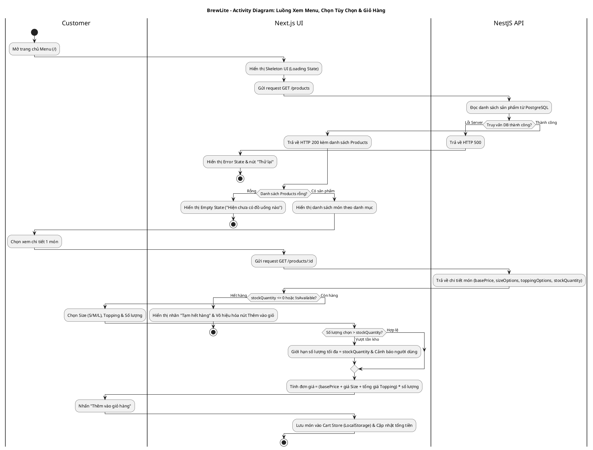
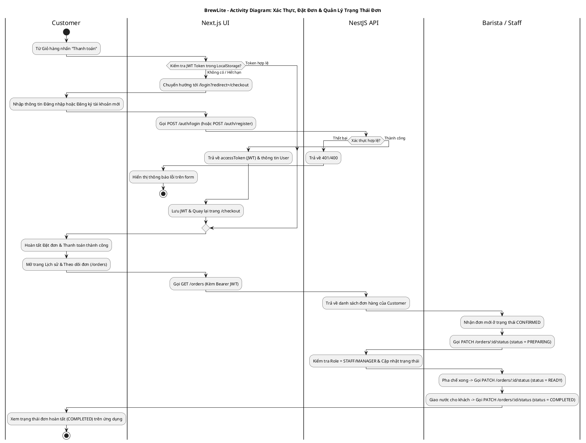
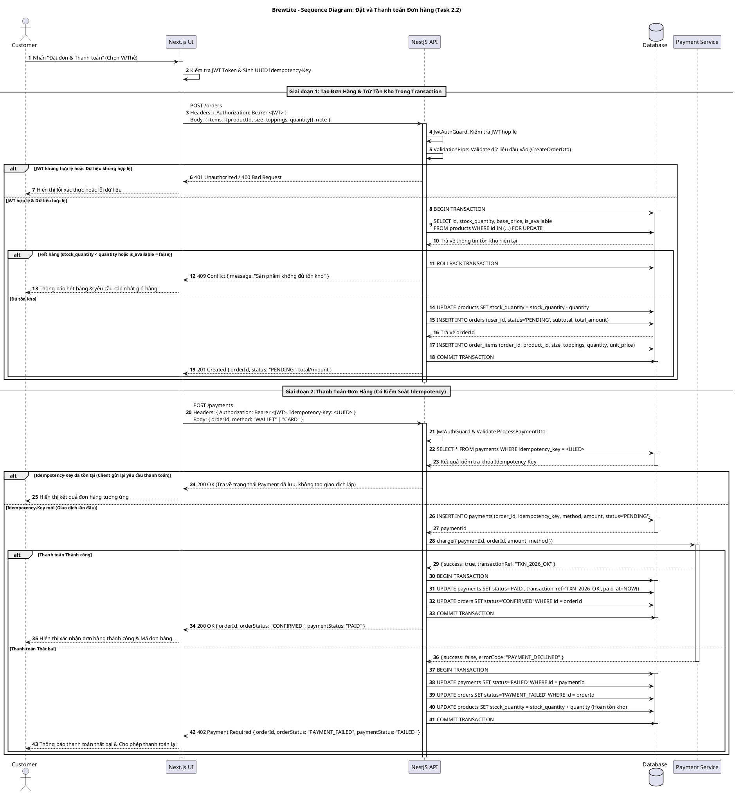
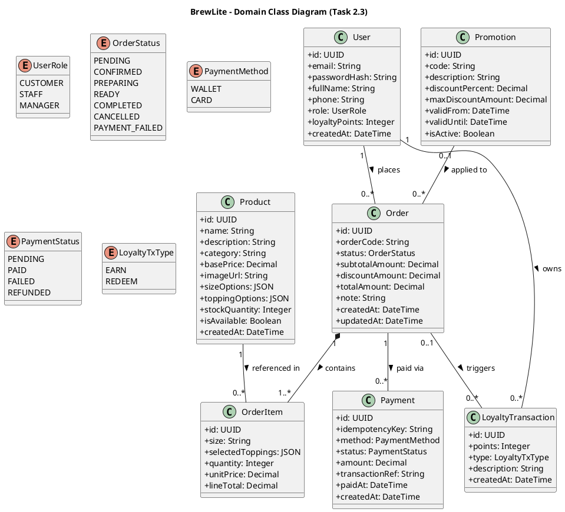
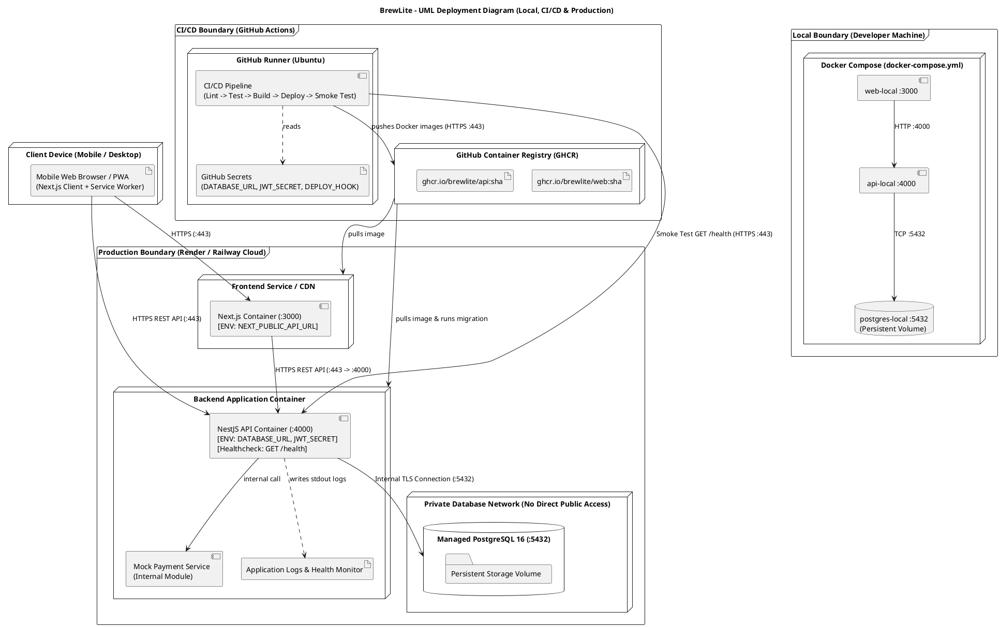

# MASTER SPECIFICATION: DỰ ÁN BREWLITE – ASSIGNMENT 2 (REQUIREMENTS TO DEPLOYMENT)

Bạn là một Principal Software Engineer & Solution Architect. Nhiệm vụ của bạn là khởi tạo, viết tài liệu, dựng sơ đồ, lập trình MVP và thiết lập CI/CD hoàn chỉnh cho dự án **BrewLite – Assignment 2**[cite: 1].

---

## NGUYÊN TẮC CỐT LÕI BẮT BUỘC TUÂN THỦ (STRICT RULES)
1. **Công nghệ bắt buộc:** Frontend dùng **Next.js** (mobile-first/PWA), Backend dùng **NestJS**, Cơ sở dữ liệu dùng **PostgreSQL** và đóng gói bằng **Docker**[cite: 1]. Không được thay thế 3 thành phần bắt buộc này[cite: 1].
2. **Thiết kế khóa chặt với Code (100% Consistency):**
   - Mọi lớp, thuộc tính, quan hệ và Enum trong `docs/diagrams/class-domain.puml` phải khớp 100% với `apps/api/prisma/schema.prisma`[cite: 1].
   - Luồng xử lý trong `apps/api` và `apps/web` phải tuân thủ đúng từng bước, mã lỗi HTTP, cơ chế Database Transaction và `Idempotency-Key` đã vẽ trong `activity-*.puml` và `sequence-checkout.puml`[cite: 1].
   - Nếu có tính năng mở rộng (`Promotion`, `LoyaltyTransaction`), phải khai báo đầy đủ trong Database Schema để khớp 100% Class Diagram[cite: 1], và gắn nhãn `Could` / `Won't (trong MVP)` ở tài liệu SRS để phạm vi code tinh gọn nhưng không lệch thiết kế[cite: 1].
3. **Lưu trữ Sơ đồ (Diagram-as-Code):** Bắt buộc lưu cả tệp nguồn `.puml` và tệp ảnh kết xuất `.svg` vào thư mục `docs/diagrams/`[cite: 1].
4. **Quy tắc thực hiện tuần tự trên Git:** Năm task phải được hoàn thành theo đúng thứ tự (`Task 1` -> `Task 2` -> `Task 3` -> `Task 4` -> `Task 5`) và có lịch sử commit/branch rõ ràng trên kho mã nguồn[cite: 1].
5. **Tách biệt hồ sơ cá nhân cho 6 thành viên (Chấm tiến độ sau Tuần 9):** Mỗi file tài liệu trong `docs/` phải ghi rõ block thông tin người phụ trách ở đầu file để từng thành viên trong nhóm 6 người (3 Chính - 3 Phụ) có thể in độc lập phần việc của mình.

---

## PHẦN 1: CẤU TRÚC THƯ MỤC REPOSITORY BẮT BUỘC

Hãy khởi tạo cây thư mục chính xác như sau[cite: 1]:

```text
brewlite/
├── apps/
│   ├── web/                                   # Next.js (App Router, TailwindCSS, Mobile-first PWA)
│   │   ├── public/
│   │   │   └── manifest.json
│   │   ├── src/
│   │   │   ├── app/
│   │   │   │   ├── layout.tsx
│   │   │   │   ├── page.tsx                   # Màn hình Menu (FR-01: Loading, Empty, Error, Out-of-stock)
│   │   │   │   ├── products/[id]/page.tsx     # Chi tiết SP + Chọn Size/Topping (FR-02)
│   │   │   │   ├── cart/page.tsx              # Giỏ hàng & Tạm tính (FR-03)
│   │   │   │   ├── login/page.tsx             # Đăng nhập & Đăng ký JWT (FR-04)
│   │   │   │   ├── checkout/page.tsx          # Đặt đơn & Thanh toán Ví/Thẻ mô phỏng (FR-05, FR-06)
│   │   │   │   └── orders/page.tsx            # Theo dõi trạng thái & Lịch sử đơn (FR-07, FR-08)
│   │   │   ├── store/useCartStore.ts
│   │   │   └── lib/api.ts
│   │   ├── Dockerfile
│   │   └── package.json
│   └── api/                                   # NestJS Backend theo Module/Domain
│       ├── prisma/
│       │   ├── schema.prisma                  # Khớp 100% Class Diagram (7 Models + 5 Enums)
│       │   ├── migrations/
│       │   └── seed.ts                        # Dữ liệu mẫu phục vụ Sprint 1 & Sprint 2
│       ├── src/
│       │   ├── modules/
│       │   │   ├── health/                    # GET /health
│       │   │   ├── auth/                      # POST /auth/register, POST /auth/login, JwtAuthGuard
│       │   │   ├── products/                  # GET /products, GET /products/:id
│       │   │   ├── orders/                    # POST /orders, GET /orders, PATCH /orders/:id/status
│       │   │   └── payments/                  # POST /payments (Xử lý Idempotency-Key & Mock Gateway)
│       │   ├── app.module.ts
│       │   └── main.ts
│       ├── test/
│       ├── Dockerfile
│       └── package.json
├── docs/
│   ├── requirements/                          # Tạo phẩm Task 1
│   │   ├── context-and-scope.md               # Phụ trách: Phụ 1 (BA 1)
│   │   ├── srs.md                             # Phụ trách: Phụ 2 (BA 2)
│   │   └── use-case-checkout.md               # Phụ trách: Phụ 3 (QA/BA 3)
│   ├── diagrams/                              # Tạo phẩm Task 2 (.puml + .svg)
│   │   ├── usecase-overall.puml
│   │   ├── usecase-overall.svg
│   │   ├── usecase-checkout.puml
│   │   ├── usecase-checkout.svg
│   │   ├── activity-end-to-end.puml
│   │   ├── activity-end-to-end.svg
│   │   ├── activity-menu-cart.puml
│   │   ├── activity-menu-cart.svg
│   │   ├── activity-auth-order-tracking.puml
│   │   ├── activity-auth-order-tracking.svg
│   │   ├── sequence-checkout.puml
│   │   ├── sequence-checkout.svg
│   │   ├── class-domain.puml
│   │   ├── class-domain.svg
│   │   ├── deployment-prod.puml
│   │   └── deployment-prod.svg
│   ├── architecture/                          # Tạo phẩm Task 3 (Phụ trách: Chính 1 - Architect)
│   │   ├── overview.md
│   │   └── adr/
│   │       ├── 001-monorepo.md
│   │       ├── 002-database-transaction.md
│   │       └── 003-mock-payment-idempotency.md
│   ├── database-and-api-design.md             # Phụ trách: Chính 2 (Backend Lead)
│   ├── ui-ux-frontend-specification.md        # Phụ trách: Chính 3 (Frontend Lead)
│   ├── traceability-matrix.md                 # Phụ trách: Phụ 3 (QA/BA 3)
│   └── deployment.md                          # Phụ trách: Chính 1 (Architect & DevOps)
├── scripts/
│   ├── render-diagrams.mjs                    # Script tự động xuất .puml sang .svg
│   └── git-sequential-commits.sh              # Script tạo lịch sử Git tuần tự 5 Task
├── tests/                                     # Integration & E2E Tests
├── .github/workflows/
│   ├── ci.yml                                 # Task 4.4: Install -> Lint -> Unit Test -> Build
│   └── cd.yml                                 # Task 5.3: Quality Gate -> Docker -> Registry -> Deploy -> Smoke Test
├── docker-compose.yml
├── .env.example
├── .gitignore
└── README.md
```

---

## PHẦN 2: BẢNG PHÂN CÔNG 6 THÀNH VIÊN & ĐÓNG GÓI HỒ SƠ IN ẤN TUẦN 9

Mỗi tài liệu được sinh ra phải đính kèm bảng Metadata ở đầu file theo đúng phân công sau để 6 thành viên tự in phần của mình khi chấm tiến độ sau tuần 9:

| Mã TV | Vai trò | File Tài Liệu & Sơ Đồ Cá Nhân Tự Ghi & Tự Photo (Tuần 9) | Phần Code Phụ Trách |
| :--- | :--- | :--- | :--- |
| **Chính 1** | **System Architect & DevOps Lead** | 1. `docs/architecture/overview.md`<br>2. `docs/architecture/adr/001-monorepo.md`, `002-...`, `003-...`<br>3. `docs/diagrams/sequence-checkout.puml` & `.svg`<br>4. `docs/diagrams/deployment-prod.puml` & `.svg`<br>5. `docs/deployment.md` | Khung Monorepo, Docker, `ci.yml`, `cd.yml`, `GET /health`. |
| **Chính 2** | **Backend & Database Lead** | 1. `docs/diagrams/class-domain.puml` & `.svg`<br>2. `docs/diagrams/activity-end-to-end.puml` & `.svg`<br>3. `docs/database-and-api-design.md` | `schema.prisma`, `OrdersModule`, `PaymentsModule` (Transaction & Idempotency). |
| **Chính 3** | **Frontend & PWA Lead** | 1. `docs/diagrams/activity-menu-cart.puml` & `.svg`<br>2. `docs/diagrams/activity-auth-order-tracking.puml` & `.svg`<br>3. `docs/ui-ux-frontend-specification.md` | `apps/web` (Next.js Mobile-first UI, PWA manifest, Cart Store, Checkout UI). |
| **Phụ 1** | **Business Analyst 1 (Scope & Data)** | 1. `docs/requirements/context-and-scope.md`<br>2. Phụ lục Danh mục Menu & Dữ liệu mẫu (`seed.ts` spec) | Chuẩn bị dữ liệu `apps/api/prisma/seed.ts` & kiểm thử dữ liệu. |
| **Phụ 2** | **Business Analyst 2 (SRS & Use-case)** | 1. `docs/requirements/srs.md`<br>2. `docs/diagrams/usecase-overall.puml` & `.svg` | Kiểm tra Acceptance Criteria trên UI/API. |
| **Phụ 3** | **QA & Traceability Lead** | 1. `docs/requirements/use-case-checkout.md`<br>2. `docs/diagrams/usecase-checkout.puml` & `.svg`<br>3. `docs/traceability-matrix.md`<br>4. `README.md` | Viết Unit/Integration/E2E Test (`tests/`) & kịch bản Demo. |

---

## PHẦN 3: MÃ NGUỒN TOÀN BỘ 7 SƠ ĐỒ PLANTUML (`.puml`) & SCRIPT RENDER `.svg`

Hãy tạo chính xác 7 file `.puml` dưới đây trong `docs/diagrams/` và chạy script xuất ra 7 file `.svg` tương ứng[cite: 1].

### 3.1. File `docs/diagrams/usecase-overall.puml` (Task 1.2 - Phụ 2 phụ trách)


### 3.2. File `docs/diagrams/usecase-checkout.puml` (Task 1.3 - Phụ 3 phụ trách)


### 3.3. File `docs/diagrams/activity-end-to-end.puml` (Task 2.1 - Chính 2 phụ trách)
Bao phủ toàn bộ luồng End-to-End và 3 nhánh bắt buộc: **hết hàng**, **chưa đăng nhập**, và **thanh toán thất bại**[cite: 1].


### 3.4. File `docs/diagrams/activity-menu-cart.puml` (Task 2.1 chi tiết - Chính 3 phụ trách)


### 3.5. File `docs/diagrams/activity-auth-order-tracking.puml` (Task 2.1 chi tiết - Chính 3 phụ trách)


### 3.6. File `docs/diagrams/sequence-checkout.puml` (Task 2.2 - Chính 1 phụ trách)
Bắt buộc giữ đúng tên file `docs/diagrams/sequence-checkout.puml` và có đủ 5 lifelines theo đề bài[cite: 1].


### 3.7. File `docs/diagrams/class-domain.puml` (Task 2.3 - Chính 2 phụ trách)
Bao gồm đầy đủ 7 lớp bắt buộc: `User`, `Product`, `Order`, `OrderItem`, `Payment`, `Promotion`, `LoyaltyTransaction` cùng thuộc tính, quan hệ, multiplicity và enum trạng thái[cite: 1].


### 3.8. File `docs/diagrams/deployment-prod.puml` (Task 3.2 - Chính 1 phụ trách)


### 3.9. Script Tự Động Xuất `.puml` Sang `.svg` (`scripts/render-diagrams.mjs`)
Hãy tạo file `scripts/render-diagrams.mjs` sử dụng API nén Deflate/PlantUML chuẩn hoặc gọi `https://kroki.io/plantuml/svg` để tự động chuyển toàn bộ 7 file `.puml` trong `docs/diagrams/` thành 7 file `.svg` hợp lệ:
```javascript
import fs from 'fs';
import path from 'path';

const diagramsDir = path.resolve('docs/diagrams');
const files = fs.readdirSync(diagramsDir).filter(f => f.endsWith('.puml'));

for (const file of files) {
  const filePath = path.join(diagramsDir, file);
  const content = fs.readFileSync(filePath, 'utf8');
  const svgPath = path.join(diagramsDir, file.replace('.puml', '.svg'));
  try {
    const res = await fetch('[https://kroki.io/plantuml/svg](https://kroki.io/plantuml/svg)', {
      method: 'POST',
      headers: { 'Content-Type': 'text/plain' },
      body: content,
    });
    if (res.ok) {
      const svg = await res.text();
      fs.writeFileSync(svgPath, svg, 'utf8');
      console.log(`Rendered: ${svgPath}`);
    } else {
      console.error(`Failed to render ${file}: ${res.status}`);
    }
  } catch (err) {
    console.error(`Error rendering ${file}:`, err.message);
  }
}
```

---

## PHẦN 4: NỘI DUNG CHI TIẾT CÁC FILE TÀI LIỆU TRONG `docs/`

Hãy tạo đầy đủ các file Markdown dưới đây với nội dung chi tiết, không dùng chữ placeholder `TODO`:

### 4.1. File `docs/requirements/context-and-scope.md` (Task 1.1 - Phụ 1 phụ trách)[cite: 1]
- **Header người phụ trách:** Thành viên Phụ 1 – Vai trò: Business Analyst 1 (Bối cảnh, Stakeholder & Phạm vi).
- **1. Vấn đề nghiệp vụ BrewLite cần giải quyết:** Giải quyết tình trạng xếp hàng chờ gọi món giờ cao điểm tại cửa hàng cà phê/trà, sai sót khi ghi nhận tùy chọn (size, đá, đường, topping) thủ công, và thiếu công cụ theo dõi trạng thái pha chế theo thời gian thực trên thiết bị di động[cite: 1].
- **2. Bảng phân tích 6 nhóm Stakeholder bắt buộc**[cite: 1]:
  - `Khách hàng (Customer)`: Xem menu nhanh trên điện thoại (PWA), tùy chọn size/topping rõ ràng, đặt đơn, thanh toán không tiền mặt và theo dõi tiến trình pha chế[cite: 1].
  - `Nhân viên quầy (Barista/Staff)`: Nhận đơn đã thanh toán chính xác, cập nhật trạng thái đơn (`CONFIRMED` -> `PREPARING` -> `READY` -> `COMPLETED`) nhanh chóng[cite: 1].
  - `Quản lý cửa hàng (Store Manager)`: Kiểm soát danh mục sản phẩm, giá bán, số lượng tồn kho (`stockQuantity`) và theo dõi doanh thu/đơn hàng[cite: 1].
  - `Giảng viên / Khách hàng nghiệm thu`: Đánh giá tính tuân thủ quy trình Công nghệ Phần mềm từ Yêu cầu -> Mô hình hóa -> Kiến trúc -> Code -> CI/CD -> Production và khả năng truy vết hai chiều[cite: 1].
  - `Nhóm phát triển (6 thành viên)`: Kiến trúc rõ ràng, dễ chia việc độc lập giữa Frontend (Next.js) và Backend (NestJS), tự động hóa kiểm thử và triển khai[cite: 1].
  - `Đơn vị thanh toán (Payment Service / Mock Gateway)`: Giao tiếp qua API chuẩn xác, đảm bảo tính `Idempotency` (không trừ tiền trùng lặp khi mạng chập chờn)[cite: 1].
- **3. Phạm vi sản phẩm (Scope):**
  - **In-Scope (Trong MVP Sprint 1 & Sprint 2):** Xem danh sách menu, xem chi tiết món, chọn size/topping, quản lý giỏ hàng, đăng ký/đăng nhập JWT, tạo đơn hàng có kiểm tra & trừ tồn kho bằng Transaction, thanh toán Ví/Thẻ mô phỏng có Idempotency, xem trạng thái và lịch sử đơn hàng, cập nhật trạng thái đơn[cite: 1].
  - **Extended Scope (Phạm vi mở rộng - Đã thiết kế sẵn DB Schema):** Áp mã khuyến mãi (`Promotion`) và tích điểm thành viên (`LoyaltyTransaction`)[cite: 1].
  - **Out-of-Scope (Không thực hiện trong đồ án):** Tích hợp cổng thanh toán ngân hàng thật (VNPay/MoMo production merchant), giao hàng qua bên thứ ba (GrabExpress/AhaMove), quản lý công thức nguyên vật liệu định lượng theo gram[cite: 1].
- **4. Giả định, Ràng buộc và Rủi ro ban đầu:**
  - *Giả định:* Khách hàng sử dụng smartphone có kết nối Internet; cổng thanh toán được mô phỏng qua module `PaymentService` nội bộ có hỗ trợ giả lập thành công/thất bại[cite: 1].
  - *Ràng buộc:* Bắt buộc dùng Next.js, NestJS, PostgreSQL và Docker; hoàn thành tuần tự 5 Task trên Git[cite: 1].
  - *Rủi ro & Giải pháp:* Rủi ro đặt trùng đơn khi khách bấm thanh toán nhiều lần -> Giải pháp: Dùng `Idempotency-Key`; Rủi ro hai khách cùng mua món chỉ còn 1 ly -> Giải pháp: Dùng Database Transaction kết hợp kiểm tra `stockQuantity`[cite: 1].

### 4.2. File `docs/requirements/srs.md` (Task 1.2 - Phụ 2 phụ trách)[cite: 1]
- **Header người phụ trách:** Thành viên Phụ 2 – Vai trò: Business Analyst 2 (Đặc tả SRS & Use-case tổng quát).
- **1. Bảng Yêu cầu Chức năng (Functional Requirements):**
  - `FR-01` (**Must** - Menu): Xem danh sách đồ uống theo danh mục. *Tiêu chí chấp nhận (AC):* `GET /products` trả về HTTP 200 dưới 500ms; UI hiển thị rõ trạng thái `loading`, `empty`, `error` và nhãn "Hết hàng" khi `stockQuantity = 0`[cite: 1].
  - `FR-02` (**Must** - Chi tiết sản phẩm): Xem chi tiết món và chọn Size (`S`, `M`, `L`) cùng Topping. *AC:* `GET /products/:id` trả về đúng cấu hình giá cộng thêm của từng size/topping; không cho chọn quá `stockQuantity`[cite: 1].
  - `FR-03` (**Must** - Giỏ hàng): Thêm, sửa số lượng, xóa món và tính tổng tiền tạm tính. *AC:* Công thức tính `lineTotal = (basePrice + sizePrice + sum(toppingPrices)) * quantity` chính xác 100%[cite: 1].
  - `FR-04` (**Must** - Xác thực): Đăng ký, đăng nhập và bảo vệ API bằng JWT. *AC:* Mật khẩu băm bằng `bcrypt`; `POST /auth/login` trả về JWT hợp lệ; gọi `POST /orders` không có JWT bị chặn với mã `401 Unauthorized`[cite: 1].
  - `FR-05` (**Must** - Đặt đơn): Tạo đơn hàng và trừ tồn kho nguyên tử. *AC:* `POST /orders` thực thi trong Database Transaction; nếu `stockQuantity < quantity` thì rollback và trả về `409 Conflict`[cite: 1].
  - `FR-06` (**Must** - Thanh toán): Thanh toán đơn hàng qua Ví (`WALLET`) hoặc Thẻ (`CARD`) mô phỏng. *AC:* `POST /payments` bắt buộc xử lý `Idempotency-Key`; nếu thanh toán thành công thì `Payment.status = PAID` và `Order.status = CONFIRMED`; nếu thất bại thì `Payment.status = FAILED`, `Order.status = PAYMENT_FAILED` và hoàn lại `stockQuantity`[cite: 1].
  - `FR-07` (**Should** - Lịch sử & Theo dõi đơn): Khách hàng xem danh sách đơn đã đặt và trạng thái hiện tại. *AC:* `GET /orders` chỉ trả về đơn của chính user đang đăng nhập[cite: 1].
  - `FR-08` (**Should** - Quản lý trạng thái đơn): Nhân viên cập nhật trạng thái đơn (`CONFIRMED` -> `PREPARING` -> `READY` -> `COMPLETED`). *AC:* `PATCH /orders/:id/status` kiểm tra hợp lệ luồng chuyển trạng thái[cite: 1].
  - `FR-09` (**Could / Won't in MVP** - Khuyến mãi & Tích điểm): Lưu trữ chương trình khuyến mãi và lịch sử điểm thưởng. *AC:* Đã có mặt đầy đủ trong Class Diagram và Prisma Schema để sẵn sàng mở rộng[cite: 1].
- **2. Bảng Yêu cầu Phi chức năng (Non-Functional Requirements):**
  - `NFR-01` (**Must** - Hiệu năng): API `GET /products` và `GET /health` phản hồi p95 < 500ms ở môi trường chuẩn[cite: 1].
  - `NFR-02` (**Must** - Bảo mật): Sử dụng HTTPS trên Production, mật khẩu băm `bcrypt`, JWT có thời hạn, biến nhạy cảm lưu trong Environment/GitHub Secrets, Database Production không public trực tiếp ra ngoài không kiểm soát[cite: 1].
  - `NFR-03` (**Must** - Tính khả dụng & Giao diện): Thiết kế Mobile-first tương thích màn hình 375px–430px, có `manifest.json` đạt chuẩn cài đặt PWA, có endpoint `GET /health` phục vụ giám sát[cite: 1].
  - `NFR-04` (**Must** - Khả năng triển khai & CI/CD): Đóng gói hoàn chỉnh qua `Dockerfile` và `docker-compose.yml`; CI tự động chặn merge nếu lint/test/build lỗi; CD tự động deploy và chạy Smoke Test[cite: 1].
- **3. Nhúng sơ đồ Use-case tổng quát:** Liên kết trực tiếp hình ảnh `../diagrams/usecase-overall.svg`[cite: 1].

### 4.3. File `docs/requirements/use-case-checkout.md` (Task 1.3 - Phụ 3 phụ trách)[cite: 1]
- **Header người phụ trách:** Thành viên Phụ 3 – Vai trò: QA & Traceability Lead.
- **Tên Use-case:** `UC-01` – Đặt và thanh toán đơn hàng (`Place and Pay Order`)[cite: 1].
- **Liên kết mã yêu cầu:** `FR-03`, `FR-04`, `FR-05`, `FR-06`, `NFR-02`[cite: 1].
- **Sơ đồ Use-case:** Nhúng `../diagrams/usecase-checkout.svg`[cite: 1].
- **Actor chính:** Khách hàng (`Customer`); **Actor phụ:** Dịch vụ thanh toán (`Payment Service`)[cite: 1].
- **Trigger:** Khách hàng nhấn nút "Đặt đơn & Thanh toán" tại màn hình Checkout[cite: 1].
- **Pre-conditions (Tiền điều kiện):** Giỏ hàng có ít nhất 1 sản phẩm; Khách hàng đã đăng nhập và có JWT Token hợp lệ[cite: 1].
- **Post-conditions (Hậu điều kiện):**
  - *Khi thành công:* Bản ghi `Order` ở trạng thái `CONFIRMED`, `Payment` ở trạng thái `PAID`, `Product.stockQuantity` giảm tương ứng số lượng mua[cite: 1].
  - *Khi thất bại:* Không có tiền bị trừ sai; số lượng `Product.stockQuantity` được bảo toàn hoặc hoàn trả nguyên vẹn[cite: 1].
- **Main Success Scenario (Luồng chính - 8 bước):** Từ lúc khách nhấn thanh toán -> UI sinh `Idempotency-Key` -> Gọi `POST /orders` -> API mở Transaction kiểm tra và trừ tồn kho -> Tạo `Order (PENDING)` -> UI gọi `POST /payments` -> `Payment Service` duyệt giao dịch -> Cập nhật `PAID` & `CONFIRMED` -> Hiển thị màn hình xác nhận đơn[cite: 1].
- **Alternative Flows (Luồng thay thế):**
  - `AF-01 (Khách gửi lặp lại yêu cầu thanh toán do mạng chậm):` Server phát hiện `Idempotency-Key` đã tồn tại trong bảng `Payment`, trả về ngay kết quả giao dịch trước đó mà không gọi lại `Payment Service`[cite: 1].
- **Exception Flows (Luồng ngoại lệ):**
  - `EF-01 (Chưa đăng nhập / JWT hết hạn):` Trả về `401 Unauthorized`, chuyển hướng sang `/login`[cite: 1].
  - `EF-02 (Sản phẩm hết hàng tại thời điểm tạo đơn):` Database Transaction rollback, trả về `409 Conflict`, thông báo khách cập nhật giỏ hàng[cite: 1].
  - `EF-03 (Thanh toán thất bại từ cổng Ví/Thẻ):` Cập nhật `Payment = FAILED`, `Order = PAYMENT_FAILED`, hoàn lại `stockQuantity` trong Transaction và trả về `402 Payment Required`[cite: 1].

### 4.4. Các File Kiến Trúc & Thiết Kế (`docs/architecture/` & Hồ sơ Chính 1, Chính 2, Chính 3)
1. **`docs/architecture/overview.md` (Chính 1 phụ trách):** Trình bày kiến trúc phân lớp kết hợp C4 (Frontend Next.js PWA -> Backend NestJS Modular Architecture -> Prisma ORM -> PostgreSQL + Mock Payment Service), cơ chế Migration Prisma, cấu hình qua biến môi trường `.env`, Structured Logging và endpoint `GET /health`[cite: 1].
2. **`docs/architecture/adr/001-monorepo.md` (Chính 1 phụ trách):** Quyết định tổ chức Monorepo (`apps/web`, `apps/api`, `docs`, `tests`) để đồng bộ tài liệu, sơ đồ, mã nguồn và CI/CD trong một kho duy nhất[cite: 1].
3. **`docs/architecture/adr/002-database-transaction.md` (Chính 1 phụ trách):** Quyết định dùng Interactive Transaction của Prisma (`prisma.$transaction`) khi tạo đơn và trừ tồn kho nhằm chống race condition khi nhiều khách đặt cùng lúc[cite: 1].
4. **`docs/architecture/adr/003-mock-payment-idempotency.md` (Chính 1 phụ trách):** Quyết định thiết kế cột `idempotencyKey UNIQUE` trong bảng `Payment` và cơ chế hoàn tồn kho tự động khi Mock Payment trả về thất bại[cite: 1].
5. **`docs/database-and-api-design.md` (Chính 2 phụ trách):** Tài liệu đặc tả chi tiết 7 bảng CSDL, giải thích quan hệ khóa ngoại và đặc tả OpenAPI/REST Contract cho toàn bộ endpoints (`GET /products`, `POST /orders`, `POST /payments`, v.v.) để Chính 2 in nộp tuần 9.
6. **`docs/ui-ux-frontend-specification.md` (Chính 3 phụ trách):** Tài liệu đặc tả kiến trúc Component Next.js, thiết kế Mobile-first PWA, quản lý trạng thái giỏ hàng (`useCartStore`) và xử lý các trạng thái `loading`, `empty`, `error` để Chính 3 in nộp tuần 9[cite: 1].
7. **`docs/traceability-matrix.md` (Phụ 3 phụ trách):** Bảng ma trận truy vết ánh xạ đầy đủ từ `FR-01..FR-09` & `NFR-01..NFR-04` sang `Use-case/User Story` -> `Sơ đồ (.puml/.svg)` -> `Code/API Endpoint` -> `Test ID (API-T01, INT-T01, E2E-T01)` theo đúng mẫu Mục 8.1 của đề bài[cite: 1].
8. **`docs/deployment.md` (Chính 1 phụ trách):** Hướng dẫn chi tiết quy trình CI/CD, cấu hình GitHub Secrets, URL Production, quy trình Smoke Test (`GET /health`), quy trình Rollback khi deploy lỗi, cùng biên bản **Sprint Review & Sprint Retrospective** của cả 2 Sprint[cite: 1].

---

## PHẦN 5: DATABASE SCHEMA & CODE HIỆN THỰC (`apps/api` & `apps/web`)

### 5.1. Prisma Schema (`apps/api/prisma/schema.prisma`) – Khớp 100% Class Diagram[cite: 1]
```prisma
generator client {
  provider = "prisma-client-js"
}

datasource db {
  provider = "postgresql"
  url      = env("DATABASE_URL")
}

enum UserRole {
  CUSTOMER
  STAFF
  MANAGER
}

enum OrderStatus {
  PENDING
  CONFIRMED
  PREPARING
  READY
  COMPLETED
  CANCELLED
  PAYMENT_FAILED
}

enum PaymentMethod {
  WALLET
  CARD
}

enum PaymentStatus {
  PENDING
  PAID
  FAILED
  REFUNDED
}

enum LoyaltyTxType {
  EARN
  REDEEM
}

model User {
  id                  String               @id @default(uuid())
  email               String               @unique
  passwordHash        String
  fullName            String
  phone               String?
  role                UserRole             @default(CUSTOMER)
  loyaltyPoints       Int                  @default(0)
  createdAt           DateTime             @default(now())
  orders              Order[]
  loyaltyTransactions LoyaltyTransaction[]
}

model Product {
  id             String      @id @default(uuid())
  name           String
  description    String
  category       String
  basePrice      Decimal     @db.Decimal(10, 2)
  imageUrl       String
  sizeOptions    Json
  toppingOptions Json
  stockQuantity  Int         @default(0)
  isAvailable    Boolean     @default(true)
  createdAt      DateTime    @default(now())
  orderItems     OrderItem[]
}

model Promotion {
  id                String   @id @default(uuid())
  code              String   @unique
  description       String
  discountPercent   Decimal  @db.Decimal(5, 2)
  maxDiscountAmount Decimal  @db.Decimal(10, 2)
  validFrom         DateTime
  validUntil        DateTime
  isActive          Boolean  @default(true)
  orders            Order[]
}

model Order {
  id                  String               @id @default(uuid())
  orderCode           String               @unique
  userId              String
  user                User                 @relation(fields: [userId], references: [id])
  promotionId         String?
  promotion           Promotion?           @relation(fields: [promotionId], references: [id])
  status              OrderStatus          @default(PENDING)
  subtotalAmount      Decimal              @db.Decimal(10, 2)
  discountAmount      Decimal              @default(0) @db.Decimal(10, 2)
  totalAmount         Decimal              @db.Decimal(10, 2)
  note                String?
  createdAt           DateTime             @default(now())
  updatedAt           DateTime             @updatedAt
  items               OrderItem[]
  payments            Payment[]
  loyaltyTransactions LoyaltyTransaction[]
}

model OrderItem {
  id               String  @id @default(uuid())
  orderId          String
  order            Order   @relation(fields: [orderId], references: [id], onDelete: Cascade)
  productId        String
  product          Product @relation(fields: [productId], references: [id])
  size             String
  selectedToppings Json
  quantity         Int
  unitPrice        Decimal @db.Decimal(10, 2)
  lineTotal        Decimal @db.Decimal(10, 2)
}

model Payment {
  id             String        @id @default(uuid())
  orderId        String
  order          Order         @relation(fields: [orderId], references: [id])
  idempotencyKey String        @unique
  method         PaymentMethod
  status         PaymentStatus @default(PENDING)
  amount         Decimal       @db.Decimal(10, 2)
  transactionRef String?
  paidAt         DateTime?
  createdAt      DateTime      @default(now())
}

model LoyaltyTransaction {
  id          String        @id @default(uuid())
  userId      String
  user        User          @relation(fields: [userId], references: [id])
  orderId     String?
  order       Order?        @relation(fields: [orderId], references: [id])
  points      Int
  type        LoyaltyTxType
  description String
  createdAt   DateTime      @default(now())
}
```

### 5.2. Yêu Cầu Hiện Thực Backend (`apps/api`) & Frontend (`apps/web`)
1. **Seed Data (`apps/api/prisma/seed.ts`):** Tạo sẵn tài khoản `customer@brewlite.vn` / `123456`, `staff@brewlite.vn` / `123456`, 1 mã khuyến mãi `WELCOME10`, và 6 sản phẩm đồ uống (trong đó có ít nhất 1 món `stockQuantity: 0` để kiểm thử nhánh "Hết hàng" trên Activity Diagram)[cite: 1].
2. **Endpoints Backend (`apps/api`):**
   - `GET /health`: Trả về `{ status: "ok", service: "brewlite-api", timestamp }`[cite: 1].
   - `GET /products` & `GET /products/:id`: Phục vụ Sprint 1[cite: 1].
   - `POST /auth/register` & `POST /auth/login`: Xác thực và cấp JWT[cite: 1].
   - `POST /orders`: Bắt buộc chạy trong `prisma.$transaction`, kiểm tra `stockQuantity < item.quantity` thì ném `ConflictException (409)`, ngược lại trừ `stockQuantity` và tạo `Order` + `OrderItem`[cite: 1].
   - `POST /payments`: Đọc header `idempotency-key`. Nếu đã tồn tại bản ghi `Payment` với key này, trả về ngay kết quả cũ (HTTP 200). Nếu chưa, hỗ trợ cờ `simulateFailure` để kiểm thử cả nhánh thành công (`PAID` / `CONFIRMED`) và nhánh thất bại (`FAILED` / `PAYMENT_FAILED` + hoàn lại `stockQuantity`) đúng như `sequence-checkout.puml`[cite: 1].
   - `GET /orders` & `PATCH /orders/:id/status`: Xem lịch sử đơn và cập nhật trạng thái đơn[cite: 1].
3. **Giao Diện Frontend (`apps/web`):**
   - Thiết kế chuẩn Mobile-first (khung nhìn di động gọn đẹp, có Bottom Navigation, hỗ trợ PWA `manifest.json`)[cite: 1].
   - Đầy đủ các màn hình: Menu (`/`), Chi tiết món (`/products/[id]`), Giỏ hàng (`/cart`), Đăng nhập (`/login`), Thanh toán (`/checkout` - có nút chọn giả lập Thanh toán Thành công hoặc Thất bại để demo trực quan cho giảng viên), và Đơn hàng của tôi (`/orders`)[cite: 1].
4. **Kiểm Thử (`apps/api/test` & `tests/`):**
   - Unit test cho logic tính tiền đơn hàng & kiểm tra tồn kho (`ProductsService`, `OrdersService`)[cite: 1].
   - Integration test cho API tạo đơn, trừ kho và thanh toán Idempotency[cite: 1].
   - E2E test cho luồng từ xem menu đến xác nhận đơn hàng[cite: 1].

---

## PHẦN 6: DOCKER & PIPELINE CI/CD (`.github/workflows/`)

1. **`docker-compose.yml`:** Định nghĩa 3 services `postgres` (port 5432, có persistent volume), `api` (port 4000, tự chạy `prisma migrate deploy` và healthcheck), và `web` (port 3000) để bất kỳ ai clone repo về đều chạy được ngay bằng 1 lệnh `docker compose up --build`[cite: 1].
2. **`.github/workflows/ci.yml` (Task 4.4):** Kích hoạt khi mở Pull Request hoặc push; thực hiện tuần tự 4 bước: `Install` -> `Lint` -> `Unit Test` -> `Build`[cite: 1].
3. **`.github/workflows/cd.yml` (Task 5.3):** Kích hoạt khi push lên `main` hoặc tạo tag `v*`; thực hiện đầy đủ chuỗi: `Quality Gate (Lint & Test)` -> `Build Docker Image (tag bằng commit SHA)` -> `Push GHCR Registry` -> `Deploy Production & Run Migration` -> `Smoke Test (curl -f GET /health)` -> `Rollback nếu Smoke Test thất bại`[cite: 1].

---

## PHẦN 7: KỊCH BẢN GIT TUẦN TỰ 5 TASK (`scripts/git-sequential-commits.sh`)

Để tuân thủ tuyệt đối **"Quy tắc thực hiện tuần tự: năm task phải được hoàn thành theo đúng thứ tự. Task sau chỉ được nghiệm thu khi các tạo phẩm bắt buộc của task trước đã có trên kho mã nguồn và có lịch sử thay đổi rõ ràng"**[cite: 1], sau khi sinh xong toàn bộ các file, hãy tạo và thực thi script `scripts/git-sequential-commits.sh` để ghi nhận lịch sử Git theo đúng 5 mốc tuần tự:

1. **Commit 1 (Task 1 - Requirements):** `git add docs/requirements/` -> `git commit -m "docs(task-1): add stakeholder analysis, SRS with MoSCoW, and checkout use-case specification"`
2. **Commit 2 (Task 2 - System Modeling):** `git add docs/diagrams/ scripts/render-diagrams.mjs` -> `git commit -m "docs(task-2): add end-to-end activity, sequence, and domain class diagrams (.puml and .svg)"`
3. **Commit 3 (Task 3 - Architecture Design):** `git add docs/architecture/ docs/database-and-api-design.md docs/ui-ux-frontend-specification.md` -> `git commit -m "docs(task-3): add architecture overview, ADRs, and production UML deployment diagram"`
4. **Commit 4 (Task 4 - Sprint 1 MVP & CI):** `git add README.md .gitignore .env.example .github/workflows/ci.yml apps/api/prisma/ apps/api/src/modules/products/ apps/api/src/modules/health/ apps/web/src/app/page.tsx` -> `git commit -m "feat(task-4): setup monorepo, CI pipeline, and Sprint 1 menu viewing MVP"`
5. **Commit 5 (Task 5 - Sprint 2 Full MVP, CD & Traceability):** `git add .` -> `git commit -m "feat(task-5): complete end-to-end checkout, idempotent payment, tests, CD pipeline, and traceability matrix"`
