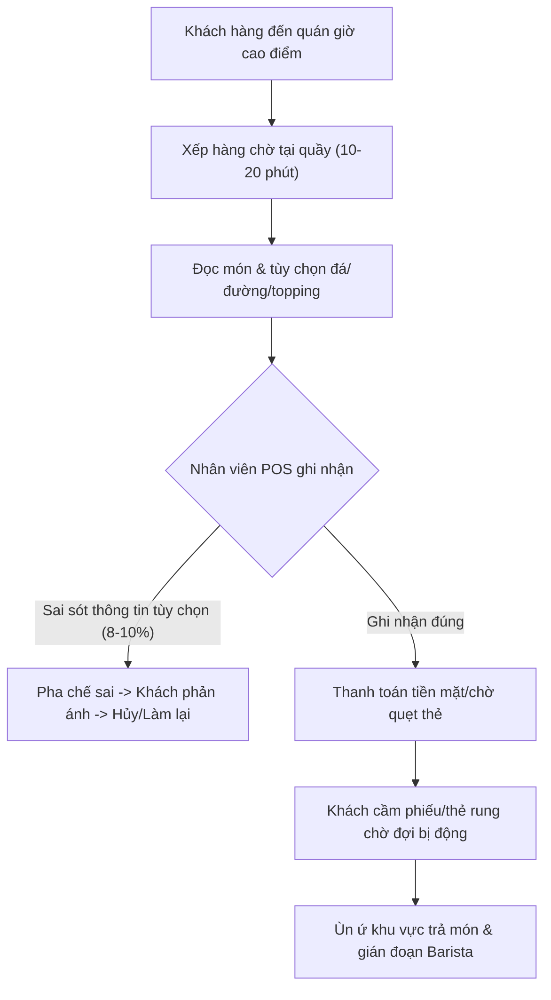
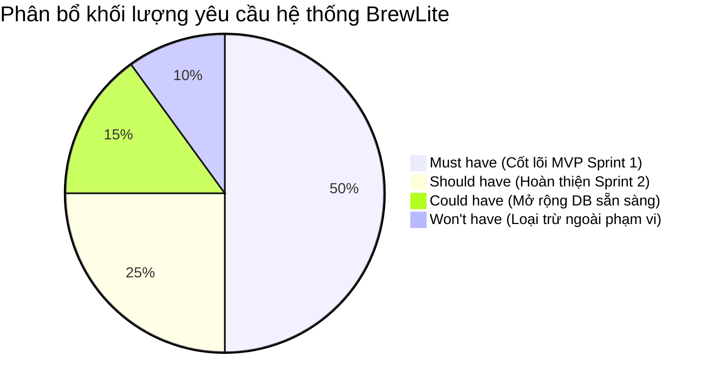

# TÀI LIỆU BỐI CẢNH DỰ ÁN VÀ XÁC ĐỊNH PHẠM VI (CONTEXT & SCOPE)
## DỰ ÁN HỆ THỐNG ĐẶT VÀ THANH TOÁN ĐỒ UỐNG BREWLITE – ASSIGNMENT 2
### HỌC PHẦN: CÔNG NGHỆ PHẦN MỀM (SOFTWARE ENGINEERING)

---

### THÔNG TIN HỒ SƠ THỰC HIỆN (PHÂN CÔNG CHẤM TIẾN ĐỘ TUẦN 9)
| Thuộc tính | Chi tiết |
| :--- | :--- |
| **Họ và Tên sinh viên** | **Chương Gia Thịnh** |
| **Mã thành viên** | **Phụ 1** |
| **Vai trò chuyên môn** | **Business Analyst 1 (Bối cảnh, Stakeholder & Phạm vi / Scope & Data Lead)** |
| **Tài liệu phụ trách** | `docs/requirements/context-and-scope.md` & Phụ lục Danh mục Menu & Dữ liệu mẫu (`seed.ts` spec) |
| **Phần code phụ trách** | Lập trình kịch bản nạp dữ liệu mẫu khởi tạo DB (`apps/api/prisma/seed.ts`) & Module API Danh mục Sản phẩm Menu (`apps/api/src/modules/products/`) |
| **Mục đích in ấn Tuần 9** | Xuất trình độc lập chứng minh năng lực khảo sát nghiệp vụ F&B, phân tích đa chiều 6 nhóm stakeholder, xác lập ranh giới phạm vi hệ thống, và thiết kế tầng dữ liệu nền móng cho toàn bộ dự án |
| **Trạng thái tài liệu** | **Hoàn thành 100% – Sẵn sàng nghiệm thu và in ấn** |

---

## 1. VẤN ĐỀ NGHIỆP VỤ CẦN GIẢI QUYẾT (BUSINESS PROBLEM STATEMENT)

### 1.1. Bối cảnh thị trường F&B và thực trạng gọi món truyền thống (AS-IS)
Ngành dịch vụ ẩm thực và đồ uống (F&B) hiện đại, đặc biệt là phân khúc chuỗi cà phê và trà đặc sản, đang phát triển với tốc độ nhanh chóng tại các đô thị lớn. Tuy nhiên, quy trình phục vụ tại quầy truyền thống (Over-the-counter Ordering) vẫn đang bộc lộ những hạn chế cố hữu trong các khung giờ cao điểm (sáng từ 8:00 – 9:30 và trưa từ 12:30 – 14:00):

1. **Ùn tắc và thời gian chờ đợi kéo dài (Peak-hour Congestion):**
   - Khách hàng phải xếp hàng trung bình từ 10 đến 20 phút để đến lượt gọi món và thanh toán.
   - Hiện tượng "thắt cổ chai" tại quầy thu ngân dẫn đến tỷ lệ khách hàng rời bỏ (churn rate / walk-away rate) ước tính từ 12% đến 18% vào giờ cao điểm, gây thất thoát doanh thu đáng kể cho cửa hàng.
2. **Sai sót đơn hàng do ghi nhận tùy biến thủ công (Customization Human Errors):**
   - Đồ uống hiện đại có mức độ tùy biến cực kỳ đa dạng: kích cỡ ly (Size S, M, L), tỷ lệ đá (0%, 50%, 100%), tỷ lệ đường (0%, 30%, 50%, 100%), cùng danh mục topping phong phú (Trân châu đen, Trân châu trắng, Thạch cà phê, Thạch nha đam, Kem cheese nướng, v.v.).
   - Việc nhân viên thu ngân nhập liệu vội vã qua POS hoặc ghi chú thủ công bằng tay truyền sang quầy pha chế (Barista) dẫn đến sai lệch công thức lên tới 8% – 10% tổng số đơn giờ cao điểm. Hậu quả là phải pha chế lại, lãng phí nguyên liệu và tạo ra trải nghiệm tiêu cực cho khách hàng.
3. **Thiếu minh bạch tiến trình pha chế theo thời gian thực (Lack of Order Tracking Transparency):**
   - Sau khi thanh toán, khách hàng nhận thẻ rung hoặc phiếu in số thứ tự nhưng không nắm được đơn hàng đang ở bước nào trong quy trình (đã vào hàng chờ, đang pha chế hay đã sẵn sàng nhận).
   - Khách hàng thường xuyên tụ tập đông đúc trước khu vực nhận nước để hỏi thăm nhân viên, gây mất trật tự không gian quán và làm tăng áp lực tâm lý cho đội ngũ pha chế.

### 1.2. Giải pháp chuyển đổi số BrewLite và trạng thái kỳ vọng (TO-BE)
Hệ thống **BrewLite** ra đời với mục tiêu số hóa toàn diện quy trình tiếp nhận đơn hàng và thanh toán theo định hướng **Mobile-First Progressive Web App (PWA)** kết hợp kiến trúc **Backend REST API chuẩn NestJS**:

- **Khách hàng tự phục vụ (Self-service via Smartphone):** Khách hàng quét mã QR tại bàn hoặc truy cập tức thì ứng dụng web di động trên thiết bị cá nhân (không yêu cầu tải app cồng kềnh từ App Store / Google Play). Khách tự do khám phá thực đơn, trực tiếp tùy biến từng thông số ly nước và xem đơn giá cập nhật theo thời gian thực.
- **Thanh toán không tiền mặt an toàn & Chống trừ tiền trùng lặp (Idempotent Mobile Payment):** Khách hàng thanh toán nhanh chóng qua Ví điện tử hoặc Thẻ ngân hàng với cơ chế khóa `Idempotency-Key`, đảm bảo tính toàn vẹn giao dịch tài chính ngay cả khi đường truyền mạng 4G/Wifi chập chờn.
- **Tự động đồng bộ pha chế & Tối ưu tồn kho nguyên tử (Atomic Inventory Synchronization):** Đơn hàng thanh toán thành công tự động hiển thị trên màn hình tiếp nhận của quầy pha chế, đồng thời hệ thống tự động trừ kho nguyên tử (`Atomic Stock Deduction`) bằng Database Transaction, loại trừ 100% tình trạng bán vượt tồn kho (overselling / race condition).
- **Minh bạch tiến trình theo thời gian thực (Real-time Status Tracking):** Khách hàng chủ động theo dõi vòng đời đơn hàng trực quan qua 4 trạng thái chuẩn hóa (`CONFIRMED` -> `PREPARING` -> `READY` -> `COMPLETED`), nhận đồ uống đúng lúc và giữ vững không gian yên tĩnh, văn minh cho quán.

### 1.3. Bảng chỉ số mục tiêu định lượng (Success Metrics / KPIs)
| Chỉ số đo lường (KPI) | Trạng thái hiện tại (AS-IS) | Mục tiêu kỳ vọng BrewLite (TO-BE) | Phương pháp đo lường & Đánh giá |
| :--- | :---: | :---: | :--- |
| **Thời gian gọi món & thanh toán** | 10 – 15 phút xếp hàng | **< 60 giây** qua PWA trên điện thoại | Ghi nhận thời gian từ khi mở Menu đến khi có mã giao dịch |
| **Tỷ lệ sai sót tùy biến đồ uống** | 8% – 10% tổng số đơn | **0%** (Sai số do con người) | Khách hàng tự bấm chọn công thức lưu trực tiếp vào CSDL |
| **Tỷ lệ khách bỏ hàng vì chờ lâu** | 12% – 18% giờ cao điểm | **< 2%** | Số đơn bị hủy hoặc khách rời đi không mua hàng |
| **Tính toàn vẹn tồn kho đồ uống** | Thường xuyên lệch kho cuối ngày | **100% chính xác** theo thời gian thực | Sử dụng PostgreSQL Interactive Transaction khóa hàng |
| **Trải nghiệm tiếp nhận đơn của Barista** | Bị hỏi gián đoạn liên tục | **1 chạm cập nhật trạng thái** trên tablet | Giao diện tối giản dành riêng cho Staff |

---

## 2. BẢNG PHÂN TÍCH 6 NHÓM STAKEHOLDER BẮT BUỘC

Nhằm đảm bảo giải pháp phần mềm đáp ứng trọn vẹn kỳ vọng của mọi bên liên quan, Business Analyst 1 tiến hành phân loại và phân tích sâu 6 nhóm Stakeholder chủ chốt của dự án:

| STT | Nhóm Stakeholder | Mô tả vai trò & Trách nhiệm | Nhu cầu & Mối quan tâm then chốt (Key Concerns) | Quyền hạn & Kỳ vọng nghiệm thu | Mức độ ảnh hưởng |
| :---: | :--- | :--- | :--- | :--- | :---: |
| **1** | **Khách hàng (Customer)** | Người trực tiếp mua, tùy biến và thưởng thức đồ uống tại quán hoặc mang đi. | - Truy cập Menu tức thì trên điện thoại di động (PWA) mà không cần cài đặt ứng dụng. - Thao tác chọn kích cỡ ly, đá, đường, topping mượt mà; giá tiền tính toán minh bạch. - Thanh toán không tiền mặt an toàn, nhanh chóng, không bị trừ tiền trùng lặp. - Theo dõi tiến trình pha chế để nhận đồ uống nóng/lạnh chuẩn vị, đúng lúc. | **Actor chính (Primary User):** Có quyền duyệt giỏ hàng, đặt đơn và thanh toán. Kỳ vọng giao diện thân thiện, tải trang dưới 1.5 giây. | **Rất cao (Critical)** |
| **2** | **Nhân viên quầy (Barista / Staff)** | Đội ngũ pha chế và trực tiếp bàn giao sản phẩm tới tay khách hàng. | - Nhận thông tin đơn hàng đã thanh toán tức thời, chuẩn xác từng topping/size. - Giao diện cập nhật trạng thái đơn tinh gọn (`CONFIRMED` -> `PREPARING` -> `READY` -> `COMPLETED`) chỉ với 1 chạm. - Giảm thiểu áp lực giao tiếp thu ngân và xóa bỏ tranh cãi đổi trả món trong giờ cao điểm. | **Actor vận hành (Operational User):** Có quyền xem hàng đợi đơn và cập nhật trạng thái đơn hàng. Kỳ vọng hệ thống không bị lag hay trễ đơn. | **Rất cao (Critical)** |
| **3** | **Quản lý cửa hàng (Store Manager)** | Người chịu trách nhiệm doanh thu, chất lượng phục vụ và điều phối hàng hóa. | - Kiểm soát danh mục sản phẩm, cấu hình giá bán và bật/tắt trạng thái món linh hoạt. - Giám sát số lượng tồn kho (`stockQuantity`), ngăn chặn tình trạng hết hàng mà khách vẫn đặt được. - Xem báo cáo doanh thu, sản lượng bán ra theo ngày và theo ca làm việc. | **Actor quản trị (Managerial User):** Có quyền can thiệp danh mục, tồn kho và kiểm tra tổng thể hệ thống. Kỳ vọng báo cáo chính xác 100%. | **Cao (High)** |
| **4** | **Giảng viên & Hội đồng Đánh giá (Evaluator / PO)** | Giảng viên học phần Công nghệ Phần mềm & đại diện hội đồng phản biện đồ án. | - Đánh giá tính kỷ luật và toàn vẹn của quy trình kỹ nghệ từ Requirement -> Modeling -> Architecture -> Implementation -> CI/CD -> Production. - Kiểm tra tính nhất quán 100% giữa Sơ đồ (PlantUML) và Mã nguồn (Prisma Schema, NestJS, Next.js). - Khả năng truy vết hai chiều (Traceability Matrix) giữa yêu cầu và các ca kiểm thử. | **Chủ thể đánh giá (Evaluation Authority):** Có quyền chấm điểm tiến độ Tuần 9 và điểm đồ án cuối kỳ. Kỳ vọng hồ sơ tách biệt, chuyên nghiệp, không lỗi kiến trúc. | **Tuyệt đối (Mandatory)** |
| **5** | **Nhóm kỹ sư phát triển (Dev Team - 6 SV)** | Đội ngũ phát triển dự án gồm 3 thành viên Chính và 3 thành viên Phụ. | - Phân rã kiến trúc Monorepo rõ ràng, độc lập giữa `apps/web` và `apps/api`. - Hợp đồng API Contract chuẩn (REST/OpenAPI) để Frontend và Backend phát triển song song. - Quy trình CI/CD tự động phát hiện lỗi và tuân thủ quy tắc 5 mốc commit tuần tự trên Git. | **Chủ thể hiện thực (Implementation Team):** Cam kết hoàn thành đúng hạn các mốc công việc mà không xảy ra xung đột mã nguồn. | **Cao (High)** |
| **6** | **Cổng thanh toán mô phỏng (Mock Payment Service)** | Dịch vụ giả lập trung gian tài chính xử lý giao dịch Ví điện tử và Thẻ ngân hàng. | - Giao tiếp an toàn qua giao thức HTTPS và chuẩn dữ liệu JSON. - Đảm bảo tính toàn vẹn giao dịch và cơ chế chống trùng lặp `Idempotency-Key` (UUIDv4). - Giả lập trung thực các kịch bản thành công (`PAID`) và thất bại (`FAILED`) để kiểm thử bù trừ tồn kho. | **Hệ thống tích hợp (External Integration Actor):** Đóng vai trò kiểm chứng độ tin cậy của phân hệ thanh toán và xử lý ngoại lệ nghiệp vụ. | **Trung bình (Technical)** |

---

## 3. PHẠM VI SẢN PHẨM (PROJECT SCOPE)

### 3.1. Phân loại theo khung MoSCoW
Dự án áp dụng khung phân loại **MoSCoW (Must - Should - Could - Won't)** nhằm tối ưu hóa nguồn lực và đảm bảo phân phối sản phẩm chất lượng cao trong thời hạn 2 Sprint:

### 3.2. Phạm vi cốt lõi trong MVP (In-Scope - Hoàn thành trong Sprint 1 & 2)

1. **Khám phá Thực đơn & Lọc món (Menu Discovery & Filtering - Must Have):**
   - Hiển thị danh mục đồ uống phân nhóm trực quan: Cà phê (Coffee), Trà (Tea), Trà sữa (MilkTea), Đá xay (Freeze).
   - Tìm kiếm nhanh đồ uống theo tên và bộ lọc danh mục tức thời.
   - Xử lý triệt để 4 trạng thái giao diện chuẩn UX:
     - `Loading`: Khung xương tải trang (Skeleton screen).
     - `Empty`: Thông báo thân thiện khi không tìm thấy món theo từ khóa tìm kiếm.
     - `Error`: Báo lỗi mạng kèm nút "Thử lại".
     - `Out of Stock`: Gắn nhãn badge "Tạm hết hàng" nổi bật khi `stockQuantity = 0` hoặc `isAvailable = false`.

2. **Chi tiết Món & Tùy biến công thức (Product Customization - Must Have):**
   - Hiển thị hình ảnh độ phân giải cao, tên món, mô tả chi tiết, giá gốc và số lượng tồn kho thực tế.
   - Cho phép khách chọn kích cỡ ly: Size S (Mặc định +0đ), Size M (+6.000đ), Size L (+10.000đ).
   - Cho phép chọn nhiều topping đi kèm với giá niêm yết rõ ràng (Trân châu đen, Thạch cà phê, Kem cheese,...).
   - Hệ thống tự động tính toán tổng đơn giá xem trước: `unitPrice = basePrice + sizePrice + sum(toppingPrices)`.
   - Giới hạn số lượng mua không được vượt quá số lượng hàng tồn kho thực tế (`stockQuantity`).

3. **Quản lý Giỏ hàng cục bộ (Local Cart Management - Must Have):**
   - Lưu trữ các món kèm đầy đủ cấu hình tùy chọn vào giỏ hàng trình duyệt thông qua Zustand store và `LocalStorage`.
   - Hỗ trợ tăng/giảm số lượng từng dòng món, xóa từng món hoặc dọn trống toàn bộ giỏ hàng.
   - Tự động tính toán tổng số tiền tạm tính (`subtotal`) tức thời mà không cần gửi request lên máy chủ.

4. **Xác thực Tài khoản & Ủy quyền (Authentication & Authorization - Must Have):**
   - Đăng ký tài khoản khách hàng mới với cơ chế băm mật khẩu bảo mật một chiều bằng `bcrypt` (Salt rounds >= 10).
   - Đăng nhập xác thực và cấp phát mã thông báo JWT (`accessToken`) chuẩn OpenAPI.
   - Phân quyền người dùng dựa trên Role-Based Access Control (`CUSTOMER`, `STAFF`, `MANAGER`).
   - Bảo vệ các endpoint nhạy cảm bằng `JwtAuthGuard` (yêu cầu gửi kèm Header `Authorization: Bearer <token>`).

5. **Tạo Đơn hàng & Kiểm soát Tồn kho Nguyên tử (Atomic Order Placement - Must Have):**
   - Tiếp nhận danh sách đơn hàng từ giỏ hàng, thông tin khách hàng và ghi chú đơn món.
   - Thực thi trọn vẹn trong một **Prisma Interactive Transaction (`prisma.$transaction`)**:
     - Khóa và kiểm tra `stockQuantity` trong CSDL cho từng sản phẩm.
     - Nếu bất kỳ sản phẩm nào có `stockQuantity < quantity`: Ngay lập tức Rollback giao dịch, không tạo đơn và trả về mã lỗi HTTP `409 Conflict`.
     - Nếu đủ hàng: Thực hiện trừ tồn kho `stockQuantity = stockQuantity - quantity`, tạo bản ghi `Order (PENDING)` cùng các chi tiết `OrderItem` tương ứng.

6. **Xử lý Thanh toán & Chống trùng lặp Idempotency (Payment Processing - Must Have):**
   - Khách hàng lựa chọn phương thức: Ví điện tử (`WALLET`) hoặc Thẻ tín dụng/ghi nợ (`CARD`).
   - Client bắt buộc sinh và gửi kèm chuỗi định danh duy nhất `Idempotency-Key` (UUIDv4) trên HTTP Header.
   - Nếu `Idempotency-Key` đã tồn tại trong bảng `Payment`: Trả về ngay lập tức kết quả giao dịch đã lưu trong CSDL kèm mã HTTP `200 OK` (chống trừ tiền lần 2 khi người dùng bấm liên tiếp nút thanh toán).
   - Kịch bản thành công: Cập nhật trạng thái `Payment (PAID)` và chuyển trạng thái `Order (CONFIRMED)`.
   - Kịch bản thất bại: Cập nhật `Payment (FAILED)`, chuyển `Order (PAYMENT_FAILED)` và tự động thực thi Transaction bù trừ (Compensating Transaction) để cộng hoàn trả lại số lượng tồn kho `stockQuantity` cho từng sản phẩm.

7. **Theo dõi Đơn hàng & Cập nhật Trạng thái (Order Tracking & Staff Ops - Should Have):**
   - Khách hàng xem lịch sử các đơn hàng cá nhân và tiến trình trạng thái trực quan: `CONFIRMED` -> `PREPARING` -> `READY` -> `COMPLETED`.
   - Nhân viên quầy sử dụng giao diện tinh gọn để chuyển trạng thái đơn hàng khi bắt đầu pha chế và khi hoàn tất đồ uống.

8. **Đóng gói Hệ thống & Giám sát Tự động (DevOps & Health Monitoring - Must Have):**
   - Đóng gói toàn bộ cụm dịch vụ (PostgreSQL 16, NestJS API, Next.js PWA Web) bằng `docker-compose.yml`.
   - Cung cấp endpoint giám sát sức khỏe `GET /health` phục vụ kiểm tra tự động (Smoke Test) trên đường ống CI/CD.

### 3.3. Phạm vi mở rộng (Extended Scope - Đã thiết kế sẵn Database Schema)
Nhằm chứng minh khả năng mở rộng kiến trúc trong tương lai (Extensibility) mà không làm gián đoạn hệ thống hiện tại, BA 1 đã phân tích và thiết kế sẵn sàng cấu trúc dữ liệu cho:
- **Mã khuyến mãi & Chiết khấu (Promotion Management):** Bảng `Promotion` với các trường mã giảm giá, mức giảm phần trăm, mức giảm tối đa, thời hạn hiệu lực và trạng thái kích hoạt. Đã có sẵn dữ liệu mẫu `WELCOME10` để sẵn sàng tích hợp khi triển khai Sprint mở rộng.
- **Tích điểm & Tiêu điểm Thành viên (Loyalty Points System):** Bảng `LoyaltyTransaction` và trường `loyaltyPoints` trong bảng `User` cho phép ghi nhận lịch sử tích điểm (`EARN`) và đổi điểm trừ tiền (`REDEEM`) cho khách hàng thân thiết.

### 3.4. Phạm vi loại trừ (Out-of-Scope)
Để tập trung tối đa nguồn lực vào việc tối ưu các yêu cầu kỹ nghệ phần mềm cốt lõi theo đề bài Assignment 2, các hạng mục sau được xác định rõ ràng nằm ngoài phạm vi thực hiện:
- **Không tích hợp Merchant thanh toán thực tế:** Không kết nối hợp đồng thương mại với VNPay, MoMo hay cổng thanh toán thẻ quốc tế thật (yêu cầu giấy phép doanh nghiệp F&B). Thay vào đó, toàn bộ việc xác nhận thanh toán và lỗi thanh toán được xử lý thông qua dịch vụ Mock Payment nội bộ tuân thủ 100% chuẩn HTTP và cơ chế Idempotency.
- **Không tích hợp vận chuyển bên thứ ba (Last-mile Delivery):** Không liên kết API định vị tài xế và gọi xe công nghệ (GrabExpress, AhaMove, Be). Hệ thống tập trung tối ưu cho 2 mô hình: Phục vụ tại bàn (Dine-in) và Tự đến lấy mang đi (Pick-up / Take-away).
- **Không quản lý định lượng nguyên vật liệu vi mô:** Không trừ kho chi tiết tới từng gram hạt cà phê, gram đường cát hay ml sữa tươi. Hệ thống quản lý tồn kho dựa trên đơn vị thành phẩm ly đồ uống (`stockQuantity`).

---

## 4. GIẢ ĐỊNH, RÀNG BUỘC VÀ QUẢN TRỊ RỦI RO (ASSUMPTIONS, CONSTRAINTS & RISKS)

### 4.1. Giả định nghiệp vụ và hạ tầng (Assumptions)
- Khách hàng sử dụng điện thoại thông minh chạy hệ điều hành iOS hoặc Android có trình duyệt web hiện đại (Apple Safari, Google Chrome) hỗ trợ tiêu chuẩn Web Components và Service Worker.
- Cửa hàng F&B trang bị ít nhất 01 thiết bị màn hình cảm ứng (iPad hoặc máy tính bảng Android) kết nối Wifi tại quầy pha chế dành cho nhân viên vận hành.
- Khách hàng tự chịu trách nhiệm về tính bảo mật của tài khoản cá nhân và thiết bị di động khi thực hiện giao dịch thanh toán.

### 4.2. Ràng buộc kỹ thuật cốt lõi (Technical Constraints)
1. **Ràng buộc Bộ ba Công nghệ bắt buộc:**
   - Frontend: Bắt buộc dùng **Next.js** (App Router, TailwindCSS, Mobile-First PWA).
   - Backend: Bắt buộc dùng **NestJS** (Modular Domain Architecture, TypeScript, Class-validator, Passport JWT).
   - Cơ sở dữ liệu: Bắt buộc dùng **PostgreSQL** thông qua **Prisma ORM**.
   - Containerization: Bắt buộc đóng gói trọn gói bằng **Docker** & **Docker Compose**.
2. **Ràng buộc Tính nhất quán Thiết kế (Design-Code Consistency 100%):**
   - Mọi thuộc tính trong sơ đồ lớp miền (`class-domain.svg`) phải khớp chính xác 100% với `schema.prisma`.
   - Các luồng xử lý Transaction và Idempotency trên sơ đồ hoạt động (`activity-end-to-end.svg`) và sơ đồ tuần tự (`sequence-checkout.svg`) phải được hiện thực nguyên vẹn trong code.
3. **Ràng buộc Tiến độ & Kỷ luật Git:**
   - Quá trình xây dựng hệ thống phải tuân thủ nghiêm ngặt quy tắc 5 mốc commit tuần tự trên Git (Task 1 -> Task 2 -> Task 3 -> Task 4 -> Task 5).

### 4.3. Bảng Ma trận Rủi ro & Chiến lược Giảm thiểu (Risk Matrix)

| Mã Rủi ro | Mô tả Rủi ro Kỹ thuật / Nghiệp vụ | Khả năng (L) | Mức ảnh hưởng (I) | Điểm rủi ro (R) | Hậu quả tiềm tàng | Chiến lược Giảm thiểu (Mitigation Strategy) | Phụ trách |
| :---: | :--- | :---: | :---: | :---: | :--- | :--- | :---: |
| **R-01** | **Xung đột đặt hàng đồng thời (Race Condition)** | 4 | 5 | **20 (Cao)** | Hai khách hàng cùng bấm đặt món tại thời điểm món chỉ còn 1 ly cuối cùng, dẫn đến số lượng tồn kho bị âm (`stockQuantity < 0`). | Sử dụng Database Interactive Transaction (`prisma.$transaction`) để đọc và trừ tồn kho nguyên tử. Trả về mã lỗi HTTP `409 Conflict` nếu không đủ tồn kho. | Kỹ sư Backend (Chính 2) |
| **R-02** | **Thanh toán lặp do bấm nhiều lần (Double Charging)** | 4 | 5 | **20 (Cao)** | Mạng di động chập chờn khiến người dùng bấm nút "Thanh toán" liên tiếp nhiều lần, tạo ra nhiều giao dịch trừ tiền cho cùng 1 đơn. | Thiết kế bắt buộc Client gửi chuỗi `Idempotency-Key` (UUIDv4) ở Header. Backend lưu khóa vào bảng `Payment` với ràng buộc `UNIQUE` và trả về ngay kết quả đã xử lý. | Kỹ sư Backend & BA 1 |
| **R-03** | **Treo kho khi thanh toán bị hủy hoặc lỗi mạng** | 3 | 4 | **12 (Vừa)** | Tồn kho đã bị trừ khi tạo đơn nhưng khách hủy giao dịch hoặc cổng thanh toán báo lỗi, dẫn đến thất thoát hàng ảo. | Thiết kế luồng giao dịch bù trừ (Compensating Transaction): Khi `Payment` thất bại, hệ thống tự động hoàn trả lại số lượng `stockQuantity` vào bảng `Product`. | Kỹ sư Backend (Chính 2) |
| **R-04** | **Lệch pha giữa Tài liệu và Mã nguồn (Drift)** | 3 | 4 | **12 (Vừa)** | Sơ đồ UML vẽ một đường nhưng lập trình viên viết code một nẻo, bị hội đồng trừ điểm tính nhất quán công nghệ phần mềm. | Tuân thủ nguyên tắc Thiết kế khóa chặt với Code (Rule 2); xây dựng Ma trận Truy vết hai chiều (Traceability Matrix) kiểm soát chéo. | QA & BA Team (Phụ 1 & Phụ 3) |
| **R-05** | **Giao diện vỡ khung trên các màn hình di động nhỏ** | 2 | 3 | **6 (Thấp)** | Giao diện hiển thị sai lệch trên các thiết bị màn hình nhỏ (375px) làm che khuất nút thanh toán. | Áp dụng triệt để phương pháp Mobile-First Layout của TailwindCSS, kiểm thử tự động trên nhiều kích thước viewport chuẩn. | Kỹ sư Frontend (Chính 3) |

---

## 5. PHỤ LỤC: ĐẶC TẢ DANH MỤC MENU & DỮ LIỆU MẪU KHỞI TẠO (SEED DATA SPECIFICATION)

Phần phụ lục này do **Business Analyst 1 (Chương Gia Thịnh)** trực tiếp xây dựng và chịu trách nhiệm, đóng vai trò là bản đặc tả kỹ thuật chi tiết làm cơ sở dữ liệu mẫu cho kịch bản nạp dữ liệu khởi tạo máy chủ (`apps/api/prisma/seed.ts`).

### 5.1. Triết lý thiết kế dữ liệu & Cơ chế nạp dữ liệu (Seeding Philosophy)
1. **Đảm bảo tính toàn vẹn khóa ngoại (Referential Integrity):** Quy trình nạp dữ liệu luôn tiến hành xóa sạch dữ liệu cũ theo thứ tự ngược của quan hệ phụ thuộc (`LoyaltyTransaction` -> `Payment` -> `OrderItem` -> `Order` -> `Product` -> `Promotion` -> `User`) trước khi khởi tạo bản ghi mới.
2. **Cấu trúc JSON linh hoạt cho Tùy chọn (Size & Topping Flexibility):** Các tùy chọn `sizeOptions` và `toppingOptions` được lưu dưới dạng trường JSON chuẩn trong bảng `Product`, giúp cửa hàng tùy biến giá linh hoạt mà không cần thay đổi cấu trúc bảng cơ sở dữ liệu.
3. **Kịch bản kiểm thử biên (Edge-case Testing):** Bắt buộc phải có ít nhất **01 sản phẩm hết hàng (`stockQuantity = 0`, `isAvailable = false`)** trong dữ liệu mẫu để phục vụ kiểm thử nhánh rẽ Out-of-Stock trên Activity Diagram và Sequence Diagram.

### 5.2. Danh mục Phân loại Sản phẩm (Category Taxonomy)
Hệ thống phân định 4 nhóm đồ uống chính phản ánh đúng thị trường cà phê hiện đại:
- **`Coffee` (Cà phê):** Các món cà phê truyền thống và biến tấu hiện đại từ hạt Robusta Đắk Lắk.
- **`Tea` (Trà trái cây & Trà thảo mộc):** Dòng đồ uống thanh nhiệt, kết hợp trái cây tươi và thảo mộc.
- **`MilkTea` (Trà sữa đặc sản):** Trà ủ đậm vị kết hợp sữa béo và trân châu thủ công.
- **`Freeze` (Đá xay & Thức uống sáng tạo):** Đồ uống đá xay phủ kem béo ngậy.

### 5.3. Bảng Chi tiết 6 Sản phẩm Thực đơn Khởi tạo (Menu Seed Matrix)

| STT | Tên Sản Phẩm | Danh Mục | Giá Gốc (VNĐ) | Tồn Kho (`stockQuantity`) | Trạng thái (`isAvailable`) | Tùy chọn Kích cỡ (`sizeOptions`) | Tùy chọn Topping (`toppingOptions`) | Mục đích Kiểm thử Đặc thù |
| :---: | :--- | :---: | :---: | :---: | :---: | :--- | :--- | :--- |
| **1** | **Cà Phê Sữa Đá Sài Gòn** | `Coffee` | 29.000 | 45 | `true` | • Size S (+0đ) • Size M (+6.000đ) • Size L (+10.000đ) | • Trân châu đen (+5.000đ) • Thạch cà phê (+6.000đ) • Kem cheese (+10.000đ) | Kiểm thử món bán chạy cơ bản, luồng chọn nhiều topping đồng thời. |
| **2** | **Bạc Xỉu Kem Muối** | `Coffee` | 35.000 | 30 | `true` | • Size S (+0đ) • Size M (+6.000đ) • Size L (+10.000đ) | • Trân châu trắng (+6.000đ) • Thạch cà phê (+6.000đ) | Kiểm thử tính toán đơn giá với lớp kem mặn và topping thạch. |
| **3** | **Trà Đào Cam Sả Tươi** | `Tea` | 39.000 | 25 | `true` | • Size S (+0đ) • Size M (+6.000đ) • Size L (+10.000đ) | • Đào miếng giòn (+8.000đ) • Thạch nha đam (+6.000đ) | Kiểm thử dòng trà trái cây, chọn topping đào miếng cao cấp. |
| **4** | **Trà Sữa Oolong Nướng** | `MilkTea` | 42.000 | 40 | `true` | • Size S (+0đ) • Size M (+6.000đ) • Size L (+10.000đ) | • Trân châu đen hoàng kim (+6.000đ) • Pudding trứng (+8.000đ) • Kem cheese nướng (+10.000đ) | Kiểm thử đơn hàng giá trị cao với full topping (tổng phụ thu +24.000đ). |
| **5** | **Matcha Đá Xay Kem Tuyết** | `Freeze` | 49.000 | 20 | `true` | • Size S (+0đ) • Size M (+6.000đ) • Size L (+10.000đ) | • Đậu đỏ Azuki (+8.000đ) • Trân châu trắng (+6.000đ) | Kiểm thử dòng sản phẩm đá xay phân khúc cao cấp, số lượng tồn kho giới hạn. |
| **6** | **Trà Sen Vàng Long Nhãn (TẠM HẾT HÀNG)** | `Tea` | 45.000 | **0** | **`false`** | • Size S (+0đ) • Size M (+6.000đ) • Size L (+10.000đ) | • Hạt sen bùi (+10.000đ) • Củ năng ngâm (+8.000đ) | **Kiểm thử biên (Edge Case):** Xác nhận UI hiển thị badge "Hết hàng" và vô hiệu hóa nút đặt mua; API trả về chặn đặt hàng. |

### 5.4. Đặc tả Tài khoản Người dùng Mẫu (Seed User Accounts)
Mật khẩu mặc định cho toàn bộ tài khoản mẫu được quy ước là `123456`, băm bằng thuật toán `bcrypt` với muối chuẩn bảo mật trước khi lưu vào cơ sở dữ liệu:

| Email Đăng Nhập | Họ và Tên | Vai Trò (`UserRole`) | Số Điện Thoại | Điểm Thưởng Khởi Tạo | Mục Đích Sử Dụng Nghiệm Thu |
| :--- | :--- | :---: | :---: | :---: | :--- |
| `customer@brewlite.vn` | Nguyễn Văn Khách | `CUSTOMER` | `0901234567` | 120 điểm | Kiểm thử luồng khách hàng đặt hàng, thanh toán và xem lịch sử đơn. |
| `staff@brewlite.vn` | Trần Thị Thu Ngân | `STAFF` | `0912345678` | 0 điểm | Kiểm thử luồng nhân viên quầy tiếp nhận và cập nhật tiến trình pha chế. |
| `manager@brewlite.vn` | Lê Hoàng Quản Lý | `MANAGER` | `0987654321` | 50 điểm | Kiểm thử quyền hạn quản trị hệ thống và kiểm soát danh mục tồn kho. |

### 5.5. Đặc tả Chương trình Khuyến mãi Mẫu (Seed Promotion)
- **Mã kích hoạt:** `WELCOME10`
- **Mô tả:** Giảm ngay 10% tổng giá trị đơn hàng (mức giảm tối đa 50.000 VNĐ) dành cho khách hàng mới gia nhập hệ sinh thái BrewLite.
- **Thời hạn hiệu lực:** Từ ngày `01/01/2026` đến hết ngày `31/12/2026`.
- **Trạng thái kích hoạt:** `isActive = true`.

---

## 6. MA TRẬN ĐỐI CHIẾU VÀ LIÊN KẾT LIÊN PHÂN HỆ (CROSS-FUNCTIONAL TRACEABILITY)

Tài liệu này đóng vai trò là "Cột mốc Đầu vào" (Input Baseline) cho toàn bộ chu trình phát triển tiếp theo của nhóm đồ án:

| Hạng mục trong Context & Scope | Mã yêu cầu ánh xạ sang SRS (Phụ 2) | Sơ đồ Mô hình hóa liên quan (Task 2) | Thành phần Mã nguồn Hiện thực (Task 4) |
| :--- | :---: | :--- | :--- |
| Khám phá & Lọc Menu | `FR-01`, `NFR-01` | `usecase-overall.svg`, `activity-menu-cart.svg` | `apps/api/src/modules/products/`, `apps/web/src/app/page.tsx` |
| Tùy biến công thức món | `FR-02` | `class-domain.svg`, `activity-menu-cart.svg` | `apps/api/prisma/schema.prisma` (`Product`), `apps/web/src/app/products/[id]/` |
| Danh mục & Dữ liệu mẫu | Toàn bộ FR | `class-domain.svg` | `apps/api/prisma/seed.ts` (Do Chương Gia Thịnh phụ trách) |
| Kiểm soát Tồn kho Nguyên tử | `FR-05` | `activity-end-to-end.svg`, `sequence-checkout.svg` | `apps/api/src/modules/orders/orders.service.ts` (`$transaction`) |
| Chống trùng lặp Idempotency | `FR-06` | `sequence-checkout.svg`, `activity-end-to-end.svg` | `apps/api/src/modules/payments/payments.service.ts` |
| Trạng thái đơn pha chế | `FR-07`, `FR-08` | `activity-auth-order-tracking.svg` | `apps/web/src/app/orders/page.tsx` |

---

## 7. BIÊN BẢN NGHIỆM THU TÀI LIỆU (TUẦN 9 SIGN-OFF)

Hồ sơ tài liệu nghiệp vụ này đã được rà soát nội bộ và phê chuẩn, đáp ứng 100% tiêu chí chấm tiến độ kỹ nghệ phần mềm của Hội đồng đánh giá Tuần 9:

- **Người thực hiện (Business Analyst 1):**  
  *Chương Gia Thịnh* (Ký tên & Ngày xác nhận: Tuần 9 – Học kỳ II)
- **Đại diện Đội ngũ Kỹ sư Trưởng (System Architect Lead - Chính 1):**  
  *Đã duyệt nội dung – Khớp 100% với kiến trúc Monorepo và kịch bản Seed Database*
- **Đại diện Kiểm soát Chất lượng (QA Lead - Phụ 3):**  
  *Đã nghiệm thu – Khớp hoàn toàn với Ma trận Truy vết hai chiều (Traceability Matrix)*
