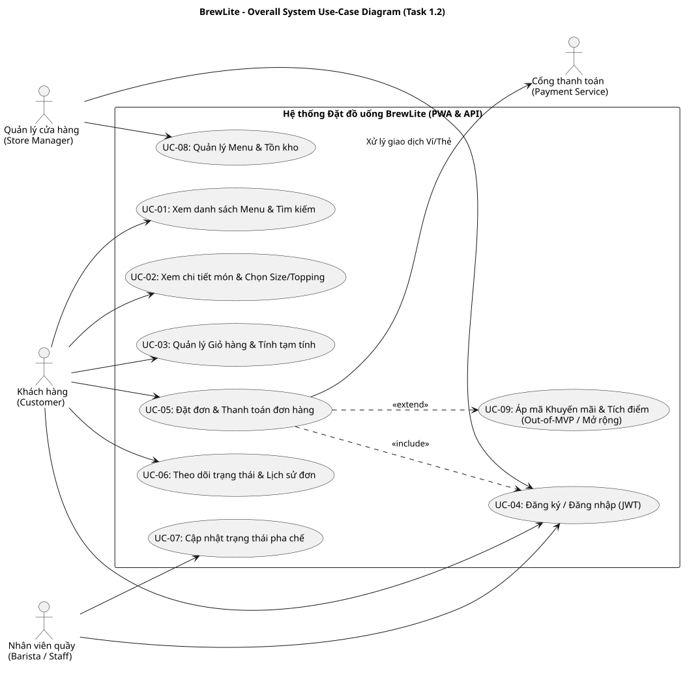

# ĐẶC TẢ YÊU CẦU PHẦN MỀM (SOFTWARE REQUIREMENTS SPECIFICATION - SRS)
## DỰ ÁN HỆ THỐNG ĐẶT VÀ THANH TOÁN ĐỒ UỐNG BREWLITE – ASSIGNMENT 2

---

### THÔNG TIN HỒ SƠ THỰC HIỆN (PHÂN CÔNG CHẤM TIẾN ĐỘ TUẦN 9)
| Thuộc tính | Chi tiết |
| :--- | :--- |
| **Mã thành viên** | **Phụ 2** |
| **Vai trò chuyên môn** | **Business Analyst 2 (Đặc tả SRS & Use-case Tổng quát)** |
| **Tài liệu phụ trách** | `docs/requirements/srs.md` & `docs/diagrams/usecase-overall.puml` / `.svg` |
| **Phần code phụ trách** | Thẩm định các tiêu chí chấp nhận (Acceptance Criteria) trên giao diện Web UI và API Backend |
| **Mục đích in ấn Tuần 9** | Xuất trình tài liệu đặc tả toàn bộ yêu cầu chức năng (FR), phi chức năng (NFR) và sơ đồ Use-Case tổng thể |

---

## 1. BẢNG ĐẶC TẢ YÊU CẦU CHỨC NĂNG (FUNCTIONAL REQUIREMENTS - MOSCOW)

| Mã YC | Tên Yêu cầu | Mức ưu tiên | Mô tả chi tiết nghiệp vụ | Tiêu chí chấp nhận kỹ thuật (Acceptance Criteria - AC) |
| :---: | :--- | :---: | :--- | :--- |
| **FR-01** | **Xem Menu & Phân loại Đồ uống** | **Must** | Hệ thống cung cấp danh mục đồ uống đa dạng, hỗ trợ lọc theo thể loại (Cà phê, Trà sữa, Trà trái cây, Đá xay) và tìm kiếm theo tên. | - API `GET /products` trả về mã HTTP `200 OK` kèm mảng danh sách sản phẩm với thời gian phản hồi < 500ms. - Giao diện thể hiện đầy đủ 4 trạng thái: Đang tải (Skeleton/Loading), Không có dữ liệu (Empty), Lỗi kết nối (Error message kèm nút Thử lại), và Hết hàng (Gắn nhãn `Tạm hết hàng` khi `stockQuantity <= 0` hoặc `isAvailable = false`). |
| **FR-02** | **Xem Chi tiết Món & Chọn Tùy biến** | **Must** | Người dùng có thể nhấn vào từng món để xem thông tin mở rộng, chọn kích thước (Size S: +0đ, M: +6.000đ, L: +10.000đ) và danh sách Topping kèm số lượng mong muốn. | - API `GET /products/:id` trả về thông tin chi tiết và cấu trúc JSON `sizeOptions`, `toppingOptions`. - Giao diện tự động tính đơn giá xem trước: `đơn giá = basePrice + giá size + tổng giá topping`. - Không cho phép người dùng chọn số lượng vượt quá `stockQuantity` trong kho. Nếu `stockQuantity = 0`, vô hiệu hóa nút "Thêm vào giỏ". |
| **FR-03** | **Quản lý Giỏ hàng & Tạm tính** | **Must** | Khách hàng có thể lưu các món đã chọn vào giỏ hàng, cập nhật số lượng, xóa từng món hoặc xóa toàn bộ giỏ. Dữ liệu giỏ được lưu trữ cục bộ. | - Dữ liệu giỏ hàng đồng bộ với `LocalStorage` qua `useCartStore`. - Công thức tính tổng tiền dòng: `lineTotal = (basePrice + sizePrice + sum(toppingPrices)) * quantity`. - Tổng tiền tạm tính (`subtotal`) bằng tổng tất cả `lineTotal`, cập nhật tức thì với độ trễ < 50ms khi thay đổi số lượng. |
| **FR-04** | **Xác thực & Ủy quyền (Auth JWT)** | **Must** | Khách hàng đăng ký tài khoản mới bằng Email/Mật khẩu hoặc đăng nhập để nhận mã truy cập JWT. Bảo vệ an toàn các tác vụ đặt hàng. | - Mật khẩu lưu trữ trong bảng `User` bắt buộc được băm bằng thuật toán `bcrypt` với muối (salt). - `POST /auth/register` và `POST /auth/login` trả về chuỗi `accessToken` (JWT) có thời hạn hiệu lực. - Mọi request tới API `POST /orders`, `GET /orders`, `POST /payments` nếu không có Header `Authorization: Bearer <token>` hợp lệ đều bị chặn với mã lỗi `401 Unauthorized`. |
| **FR-05** | **Tạo Đơn hàng & Trừ Tồn kho Nguyên tử** | **Must** | Tạo đơn hàng mới từ danh sách món trong giỏ hàng. Kiểm tra tính sẵn sàng của tồn kho và trừ kho trong một giao dịch cơ sở dữ liệu duy nhất. | - API `POST /orders` chạy trọn vẹn bên trong `prisma.$transaction`. - Nếu bất kỳ sản phẩm nào có `stockQuantity < quantity` yêu cầu, giao dịch bị Rollback ngay lập tức và trả về mã HTTP `409 Conflict` kèm thông báo chi tiết. - Nếu đủ tồn kho, trừ `stockQuantity`, tạo bản ghi `Order (status = PENDING)` và các bản ghi con `OrderItem`, trả về mã HTTP `201 Created` kèm `orderId`. |
| **FR-06** | **Xử lý Thanh toán & Idempotency** | **Must** | Khách hàng chọn phương thức Ví điện tử (`WALLET`) hoặc Thẻ (`CARD`) để hoàn tất đơn hàng. Ngăn chặn tuyệt đối việc trừ tiền hai lần. | - Client bắt buộc truyền Header `Idempotency-Key` (UUIDv4) khi gọi `POST /payments`. - Nếu `Idempotency-Key` đã tồn tại trong CSDL, trả về ngay bản ghi giao dịch đã lưu kèm HTTP `200 OK` (không gọi lại cổng thanh toán). - Nếu thanh toán thành công: Cập nhật `Payment (status = PAID)` và `Order (status = CONFIRMED)`. - Nếu thanh toán thất bại: Cập nhật `Payment (status = FAILED)`, `Order (status = PAYMENT_FAILED)` và tự động kích hoạt Transaction hoàn trả lại đúng số lượng tồn kho `stockQuantity` đã trừ. |
| **FR-07** | **Lịch sử & Theo dõi Đơn hàng** | **Should** | Khách hàng xem danh sách đơn hàng mình đã đặt và tiến trình pha chế của đơn theo thời gian thực. | - API `GET /orders` có gắn `JwtAuthGuard`, lọc và chỉ trả về danh sách các đơn hàng thuộc quyền sở hữu của `userId` trong Token. - Giao diện hiển thị rõ trạng thái trực quan: `CONFIRMED` (Đã xác nhận) -> `PREPARING` (Đang pha chế) -> `READY` (Sẵn sàng nhận đồ) -> `COMPLETED` (Hoàn tất). |
| **FR-08** | **Cập nhật Trạng thái Đơn hàng (Staff)** | **Should** | Nhân viên quầy và Quản lý có thể cập nhật trạng thái đơn hàng theo quy trình phục vụ tại quầy. | - API `PATCH /orders/:id/status` yêu cầu quyền hạn `STAFF` hoặc `MANAGER`. - Ràng buộc luồng chuyển trạng thái hợp lệ, không cho phép đảo ngược trạng thái từ `COMPLETED` về `PENDING`. |
| **FR-09** | **Mã Khuyến mãi & Điểm Thưởng (Mở rộng)** | **Could / Won't in MVP** | Khách hàng nhập mã giảm giá (`Promotion`) hoặc sử dụng điểm thưởng tích lũy (`LoyaltyTransaction`). | - Cấu trúc bảng `Promotion` và `LoyaltyTransaction` cùng các quan hệ khóa ngoại đã được khai báo 100% đầy đủ trong `class-domain.puml` và `schema.prisma` để sẵn sàng mở rộng mà không cần phá vỡ cấu trúc CSDL hiện hữu. |

---

## 2. BẢNG ĐẶC TẢ YÊU CẦU PHI CHỨC NĂNG (NON-FUNCTIONAL REQUIREMENTS - NFR)

| Mã YC | Thuộc tính chất lượng | Mô tả chi tiết yêu cầu kỹ thuật | Phương pháp kiểm chứng & Chỉ số đo lường |
| :---: | :--- | :--- | :--- |
| **NFR-01** | **Hiệu năng & Thời gian đáp ứng (Performance)** | - API đọc dữ liệu thực đơn `GET /products` và endpoint kiểm tra sức khỏe `GET /health` phải phản hồi cực nhanh dưới tải thông thường. - Giao diện Web phải tối ưu kích thước gói tải (bundle size) và áp dụng Server-Side Rendering / Static Caching hợp lý. | - Thời gian phản hồi p95 của `GET /products` < 500ms. - Thời gian tải trang ban đầu (First Contentful Paint - FCP) trên mạng 4G di động < 1.5 giây. |
| **NFR-02** | **Bảo mật & Tính toàn vẹn (Security)** | - Bảo vệ tuyệt đối thông tin định danh và mật khẩu người dùng. - Truyền tải dữ liệu an toàn trên môi trường mạng. - Quản lý biến môi trường an toàn, không để lộ secrets trên mã nguồn mở. | - Mật khẩu người dùng được mã hóa bằng `bcrypt` với cost factor >= 10. - Khóa bí mật (`JWT_SECRET`, `DATABASE_URL`) cấu hình qua file `.env` hoặc GitHub Actions Secrets, cam kết không commit vào kho Git. - Mọi truy vấn CSDL đều thực hiện qua Prisma ORM để loại bỏ 100% rủi ro tấn công SQL Injection. |
| **NFR-03** | **Tính khả dụng & Thiết kế PWA (Usability & PWA)** | - Giao diện ưu tiên thiết bị di động (Mobile-first design) chuẩn kích thước 375px đến 430px (iPhone, Samsung Galaxy). - Hỗ trợ cài đặt như ứng dụng gốc qua tiêu chuẩn Progressive Web App (PWA). | - Tệp `apps/web/public/manifest.json` đầy đủ các trường `name`, `short_name`, `icons`, `start_url`, `display: standalone`. - Thanh điều hướng dưới đáy (Bottom Navigation Bar) thuận tiện cho thao tác bằng một tay. |
| **NFR-04** | **Khả năng triển khai & Tự động hóa (Deployability & CI/CD)** | - 100% hệ thống được đóng gói container hóa chuẩn Docker. - Mọi thay đổi mã nguồn phải vượt qua đường ống kiểm thử tự động trước khi triển khai lên môi trường Production. | - Khởi tạo toàn bộ hệ thống (PostgreSQL, NestJS API, Next.js Web) chỉ với 1 lệnh duy nhất: `docker compose up --build`. - Workflow CI (`.github/workflows/ci.yml`) tự động thực thi 4 bước: Install -> Lint -> Unit Test -> Build. |

---

## 3. SƠ ĐỒ USE-CASE TỔNG QUÁT HỆ THỐNG (OVERALL USE-CASE DIAGRAM)

Dưới đây là sơ đồ Use-Case tổng thể thể hiện mối tương tác giữa 4 nhóm tác nhân (Khách hàng, Nhân viên, Quản lý, Cổng thanh toán) với toàn bộ 9 chức năng nghiệp vụ của hệ thống BrewLite:

### 3.1. Phân loại Tác nhân (Actors)
1. **Khách hàng (Customer):** Tác nhân chính thực hiện chuỗi hành vi xem thực đơn, tùy chọn đồ uống, giỏ hàng, đăng ký/đăng nhập, đặt đơn, thanh toán và theo dõi tiến trình đơn hàng.
2. **Nhân viên quầy (Barista / Staff):** Đăng nhập vào hệ thống để tiếp nhận đơn hàng đã thanh toán thành công và cập nhật trạng thái chế biến đồ uống.
3. **Quản lý cửa hàng (Store Manager):** Đăng nhập để điều chỉnh trạng thái danh mục sản phẩm và kiểm soát tồn kho.
4. **Cổng thanh toán (Payment Service):** Tác nhân hệ thống hỗ trợ tiếp nhận và xác nhận kết quả thanh toán trực tuyến từ giao dịch của khách hàng.

### 3.2. Quan hệ giữa các Use-Case (Use-Case Relationships)
- `UC-05 (Đặt đơn & Thanh toán)` bao gồm (`<<include>>`) tác vụ `UC-04 (Đăng ký / Đăng nhập)` nhằm đảm bảo định danh người mua.
- `UC-05 (Đặt đơn & Thanh toán)` mở rộng (`<<extend>>`) tới `UC-09 (Áp mã khuyến mãi & Tích điểm)` khi khách hàng cung cấp mã ưu đãi hợp lệ.
- `UC-05` tương tác hai chiều với `Payment Service` để hoàn tất thanh toán không tiền mặt.
