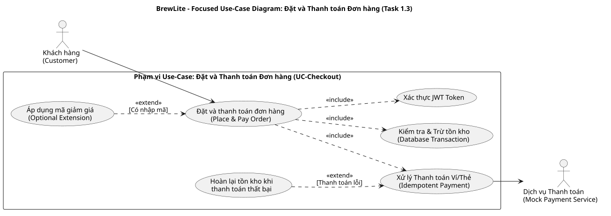

# ĐẶC TẢ CHI TIẾT USE-CASE TRỌNG TÂM: ĐẶT VÀ THANH TOÁN ĐƠN HÀNG
## DỰ ÁN HỆ THỐNG ĐẶT VÀ THANH TOÁN ĐỒ UỐNG BREWLITE – ASSIGNMENT 2

---

### THÔNG TIN HỒ SƠ THỰC HIỆN (PHÂN CÔNG CHẤM TIẾN ĐỘ TUẦN 9)
| Thuộc tính | Chi tiết |
| :--- | :--- |
| **Mã thành viên** | **Phụ 3** |
| **Vai trò chuyên môn** | **QA & Traceability Lead** |
| **Tài liệu phụ trách** | `docs/requirements/use-case-checkout.md` & `docs/diagrams/usecase-checkout.puml` / `.svg` |
| **Phần code phụ trách** | Lập trình API Health Check giám sát hệ thống (`apps/api/src/modules/health/health.controller.ts`), Bộ kiểm thử tích hợp tự động (`tests/integration-checkout.spec.ts`) & Unit Tests (`*.spec.ts`) |
| **Mục đích in ấn Tuần 9** | Xuất trình đặc tả ca sử dụng hạt nhân quan trọng nhất của hệ thống, làm căn cứ thẩm định thiết kế và kiểm thử tự động |

---

## 1. THÔNG TIN ĐẶC TẢ CA SỬ DỤNG (USE-CASE SPECIFICATION)

| Thuộc tính | Nội dung chi tiết |
| :--- | :--- |
| **Tên Use-case** | **UC-Checkout: Đặt và Thanh toán Đơn hàng (Place and Pay Order)** |
| **Mã Use-case** | `UC-05` (tương ứng use-case trọng tâm theo đề bài) |
| **Ánh xạ Yêu cầu** | `FR-03` (Giỏ hàng), `FR-04` (Xác thực JWT), `FR-05` (Đặt đơn & Trừ kho), `FR-06` (Thanh toán & Idempotency), `NFR-02` (Bảo mật giao dịch) |
| **Tác nhân chính (Primary Actor)** | **Khách hàng (Customer)** |
| **Tác nhân phụ (Supporting Actor)** | **Dịch vụ Thanh toán (Mock Payment Service)** |
| **Sự kiện kích hoạt (Trigger)** | Khách hàng nhấn nút **"Đặt đơn & Thanh toán"** trên giao diện màn hình Checkout (`apps/web/src/app/checkout/page.tsx`). |

---

## 2. SƠ ĐỒ USE-CASE PHẠM VI THANH TOÁN (FOCUSED USE-CASE DIAGRAM)



---

## 3. ĐIỀU KIỆN TRƯỚC VÀ SAU (PRE-CONDITIONS & POST-CONDITIONS)

### 3.1. Tiền điều kiện (Pre-conditions)
1. Giỏ hàng của khách hàng trên ứng dụng có ít nhất 1 sản phẩm hợp lệ (`cartItems.length > 0`).
2. Khách hàng đã hoàn tất đăng nhập và trình duyệt đang lưu giữ một chuỗi `accessToken` (JWT) còn hiệu lực trong `localStorage`.
3. Khách hàng đã chọn phương thức thanh toán mong muốn: Ví điện tử (`WALLET`) hoặc Thẻ ngân hàng (`CARD`).

### 3.2. Hậu điều kiện (Post-conditions)
- **Trường hợp Giao dịch Thành công:**
  - Một bản ghi `Order` được tạo mới trong CSDL với trạng thái `status = CONFIRMED`.
  - Các bản ghi `OrderItem` được lưu tương ứng với từng món, size và danh sách topping đã chọn.
  - Một bản ghi `Payment` được tạo với trạng thái `status = PAID` kèm mã tham chiếu giao dịch `transactionRef` và thời điểm `paidAt`.
  - Số lượng tồn kho `stockQuantity` của các sản phẩm tương ứng trong bảng `Product` được trừ chính xác.
  - Giỏ hàng của khách hàng trên máy khách được làm sạch hoàn toàn (`clearCart()`).
- **Trường hợp Giao dịch Thất bại hoặc Bị hủy:**
  - Bản ghi `Payment` ở trạng thái `status = FAILED`.
  - Bản ghi `Order` ở trạng thái `status = PAYMENT_FAILED`.
  - Số lượng tồn kho `stockQuantity` của các sản phẩm đã trừ trước đó được hoàn trả nguyên vẹn về cơ sở dữ liệu.
  - Không có bất kỳ khoản tiền nào bị trừ sai lệch từ tài khoản của khách hàng.

---

## 4. CÁC LUỒNG SỰ KIỆN CHI TIẾT (FLOWS OF EVENTS)

### 4.1. Luồng chính thành công (Main Success Scenario)

```text
[Customer] ---> [Next.js UI] ---> [NestJS API] ---> [PostgreSQL DB] ---> [Payment Service]
```

1. **Khách hàng** truy cập màn hình Thanh toán (`/checkout`), xem lại danh sách món, tổng tiền tạm tính, chọn phương thức thanh toán (`WALLET` hoặc `CARD`) và nhấn **"Đặt đơn & Thanh toán"**.
2. **Next.js UI** kích hoạt hiệu ứng tải, kiểm tra tính hợp lệ của Token JWT và tự động sinh một chuỗi định danh duy nhất `Idempotency-Key` (chuẩn UUIDv4 ngẫu nhiên).
3. **Next.js UI** gửi yêu cầu `POST /orders` tới **NestJS API** với Header `Authorization: Bearer <JWT>` và Payload chứa danh sách `items: [{ productId, size, toppings, quantity }]` cùng `note`.
4. **NestJS API** xác thực danh tính qua `JwtAuthGuard`, kiểm tra dữ liệu qua `ValidationPipe`, và khởi tạo một giao dịch CSDL tương tác (`prisma.$transaction`).
5. **NestJS API** truy vấn và khóa các bản ghi sản phẩm trong bảng `Product` để đối chiếu tồn kho:
   - Toàn bộ sản phẩm đều còn đủ số lượng bán (`stockQuantity >= quantity` và `isAvailable = true`).
6. **NestJS API** thực hiện trừ tồn kho (`stockQuantity = stockQuantity - quantity`), tạo bản ghi `Order` với trạng thái `PENDING`, chèn các bản ghi con `OrderItem`, và cam kết giao dịch (`COMMIT TRANSACTION`).
7. **NestJS API** trả về mã HTTP `201 Created` kèm thông tin đơn hàng (`orderId`, `totalAmount`, `status: "PENDING"`).
8. **Next.js UI** nhận phản hồi tạo đơn thành công, tiếp tục tự động gửi yêu cầu `POST /payments` kèm Header `Authorization` và Header `Idempotency-Key: <UUID>` cùng Body `{ orderId, method }`.
9. **NestJS API** kiểm tra bảng `Payment`: Khóa `Idempotency-Key` này chưa từng xuất hiện. API tạo bản ghi `Payment (status = PENDING)` và chuyển tiếp yêu cầu tới **Payment Service**.
10. **Payment Service** xác nhận giao dịch hợp lệ, trừ tiền thành công và trả về mã tham chiếu giao dịch `TXN_SUCCESS_<timestamp>`.
11. **NestJS API** mở transaction cập nhật `Payment (status = PAID, transactionRef)` và `Order (status = CONFIRMED)`.
12. **NestJS API** phản hồi HTTP `200 OK` về phía máy khách.
13. **Next.js UI** xóa sạch giỏ hàng hiện tại và chuyển hướng người dùng tới màn hình Theo dõi đơn hàng (`/orders`) với thông báo chúc mừng đặt hàng thành công.

---

### 4.2. Luồng thay thế (Alternative Flows)

#### AF-01: Gửi lặp lại yêu cầu thanh toán do mạng chập chờn (Idempotency Handling)
- **Điều kiện phát sinh:** Khách hàng nhấn nút thanh toán, mạng bị giật lag khiến Client gửi lại cùng một yêu cầu HTTP `POST /payments` có cùng Header `Idempotency-Key`.
- **Luồng xử lý:**
  1. Khi nhận request, **NestJS API** truy vấn bảng `Payment` theo `idempotencyKey`.
  2. Hệ thống phát hiện khóa này đã tồn tại trong cơ sở dữ liệu.
  3. Thay vì gửi lệnh thanh toán lần hai tới **Payment Service**, API ngay lập tức lấy lại kết quả giao dịch đã lưu trước đó và trả về mã HTTP `200 OK`.
  4. Giao diện máy khách hiển thị kết quả đơn hàng tương ứng một cách ổn định mà khách hàng không bao giờ bị trừ tiền hai lần.

---

### 4.3. Các luồng ngoại lệ (Exception Flows)

#### EF-01: Khách hàng chưa đăng nhập hoặc Phiên làm việc (JWT) hết hạn
- **Phát hiện:** `JwtAuthGuard` tại **NestJS API** không tìm thấy Header `Authorization` hoặc chữ ký Token không hợp lệ.
- **Xử lý:**
  1. API từ chối xử lý và phản hồi ngay mã lỗi HTTP `401 Unauthorized`.
  2. Giao diện **Next.js UI** bắt mã lỗi 401, lưu trạng thái giỏ hàng hiện tại và chuyển hướng khách hàng tới trang Đăng nhập `/login?redirect=/checkout`.
  3. Sau khi khách đăng nhập thành công, hệ thống đưa khách quay lại đúng màn hình Checkout để tiếp tục đặt đơn.

#### EF-02: Sản phẩm bị hết hàng tại thời điểm tạo đơn (Hết tồn kho đồng thời)
- **Phát hiện:** Tại bước kiểm tra tồn kho trong Database Transaction, phát hiện một món có `stockQuantity < quantity` yêu cầu (do khách khác vừa mua trước đó vài mili-giây) hoặc `isAvailable = false`.
- **Xử lý:**
  1. **NestJS API** kích hoạt lệnh `ROLLBACK TRANSACTION`, hủy bỏ hoàn toàn việc tạo đơn hàng và không làm thay đổi dữ liệu bảng `Product`.
  2. API phản hồi mã lỗi HTTP `409 Conflict` kèm thông báo tiếng Việt: *"Một hoặc nhiều món trong đơn hàng đã hết tồn kho, vui lòng kiểm tra lại giỏ hàng."*
  3. **Next.js UI** hiển thị hộp thoại cảnh báo rõ ràng cho khách hàng và hướng dẫn khách điều chỉnh số lượng trong giỏ hàng.

#### EF-03: Giao dịch thanh toán bị từ chối từ cổng Ví/Thẻ (Payment Failure)
- **Phát hiện:** **Payment Service** phản hồi giao dịch thất bại (ví dụ: số dư ví không đủ, thẻ hết hạn, lỗi kết nối cổng mô phỏng).
- **Xử lý:**
  1. **NestJS API** mở một transaction bù trừ (Compensating Transaction):
     - Cập nhật bản ghi `Payment (status = FAILED)`.
     - Cập nhật bản ghi `Order (status = PAYMENT_FAILED)`.
     - Cộng hoàn lại chính xác số lượng tồn kho `stockQuantity = stockQuantity + quantity` cho toàn bộ sản phẩm trong đơn hàng.
  2. API phản hồi mã lỗi HTTP `402 Payment Required` kèm thông điệp giải thích nguyên nhân thất bại.
  3. **Next.js UI** hiển thị thông báo thanh toán không thành công, giữ nguyên đơn hàng ở trạng thái lỗi và cung cấp nút bấm cho phép khách hàng nhấn chọn phương thức khác để thử lại.
